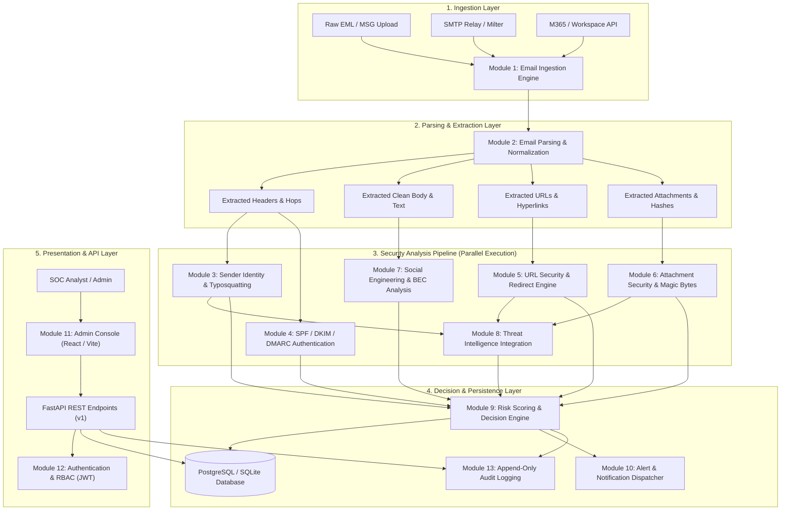
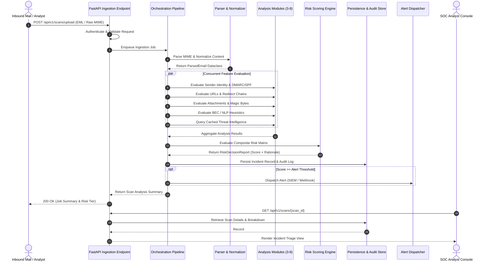

# MailSentra Architecture Specification

## 1. Executive Summary

MailSentra is structured as a **High-Cohesion, Modular Monolith**. In cybersecurity engineering, premature microservice decomposition introduces network latency, serialization overhead, distributed state complexities, and deployment friction. MailSentra isolates detection logic into cleanly decoupled domain modules connected through strictly typed Python data contracts (`contracts.py`), enabling high throughput, local determinism, and seamless future extraction into distributed worker services if scaling demands require it.

---

## 2. High-Level System Architecture Diagram

---

## 3. Detailed Component Architecture

### Component 1: Email Ingestion Module (`mailsentra/modules/ingestion`)
- **Purpose**: Handles ingestion of raw message payloads across heterogeneous transport channels.
- **Inputs**: Raw byte stream, RFC 5322 formatted file (`.eml`, `.msg`), or structured webhook payload.
- **Responsibilities**:
  - Size limitation enforcement and payload sanity validation.
  - MIME encoding boundary inspection.
  - Creation of an immutable `RawEmailPayload` container accompanied by ingestion metadata (ingestion timestamp, source IP, tenant ID).
- **Outputs**: `RawEmailPayload` object.

### Component 2: Email Parsing and Normalization Module (`mailsentra/modules/parser`)
- **Purpose**: Deconstructs raw MIME structures into a normalized, canonical representation.
- **Inputs**: `RawEmailPayload`.
- **Responsibilities**:
  - RFC 2047 header decoding (handling complex character sets like UTF-8, ISO-8859-1, Windows-1252).
  - Traversal of nested MIME trees (`multipart/alternative`, `multipart/mixed`, `multipart/related`).
  - Canonical header extraction (`Received`, `Authentication-Results`, `From`, `To`, `Subject`, `Message-ID`, `Reply-To`, `Return-Path`).
  - Text normalization: HTML stripping, entity decoding, unicode unescaping, and defanging.
  - URL extraction (handling `href` attributes, plain-text URLs, obfuscated links).
  - Attachment segregation and metadata extraction (declared filename, declared content-type, raw byte extraction).
- **Outputs**: `ParsedEmail` dataclass.

### Component 3: Sender Identity Verification Module (`mailsentra/modules/identity`)
- **Purpose**: Validates sender legitimacy, structural header integrity, display name impersonation, and cousin-domain spoofing.
- **Inputs**: Header dictionary, Envelope-From, Header-From, organizational directory, and protected brand catalog.
- **Responsibilities**:
  - Comparison of Envelope-From (`Return-Path`) vs Header-From (`From:`) vs `Reply-To:`.
  - Structural header integrity verification: detects `MALFORMED_SENDER_ADDRESS`, `DUPLICATE_FROM_HEADER`, `MISSING_FROM_HEADER`, `DUPLICATE_REPLY_TO_HEADER`, `DUPLICATE_SENDER_HEADER`, and `MISSING_SENDER_HEADER` (Priority 1).
  - Protected brand display-name impersonation detection (Priority 3): cross-references claimed brand names against offline Public Suffix List (PSL)-aware catalog of explicitly authorized domains. Applies ambiguity filtering for homonym names ("Chase", "Apple"), non-impersonation context filtering (reviews, clubs), and eliminates implicit brand-stem guessing (Risk B).
  - Executive/VIP display name impersonation detection (e.g., "Tim Cook <attacker@random.com>").
  - Typosquatting and cousin-domain detection (Levenshtein distance, Jaro-Winkler, vowel dropping, TLD swapping).
  - Internationalized Domain Name (IDN) homoglyph and Punycode attack detection (e.g., `goog1e.com`, `аpple.com` with Cyrillic 'а').
- **Outputs**: `IdentityAnalysisResult`.

### Component 4: SPF, DKIM, and DMARC Analysis Module (`mailsentra/modules/auth_protocols`)
- **Purpose**: Evaluates cryptographic and DNS-based domain authentication.
- **Inputs**: Raw headers, `Authentication-Results` header, sending MTA IP, and public DNS records.
- **Responsibilities**:
  - **SPF (RFC 7208)**: Evaluates sender IP against publishing domain SPF TXT records (`Pass`, `Fail`, `SoftFail`, `Neutral`, `None`, `PermError`, `TempError`).
  - **DKIM (RFC 6376)**: Parses `DKIM-Signature` headers, retrieves public keys via DNS selector query, validates canonicalization, cryptographic RSA/Ed25519 hash integrity.
  - **DMARC (RFC 7489)**: Checks DMARC DNS policy (`none`, `quarantine`, `reject`), evaluates identifier alignment (SPF domain vs Header-From domain, DKIM `d=` tag vs Header-From domain) under strict and relaxed modes.
- **Outputs**: `AuthProtocolsResult`.

### Component 5: URL Security Analysis Module (`mailsentra/modules/url_analysis`)
- **Purpose**: Assesses threat posture of all hyperlinks present in email headers and body.
- **Inputs**: Array of extracted raw URLs.
- **Responsibilities**:
  - URL canonicalization and defanging.
  - Subdomain Brand Impersonation detection (Priority 2): identifies legitimate brand domains embedded inside attacker-controlled subdomains while the registrable domain belongs to an unrelated third party (e.g. `signin.paypal.com.evil.org`), using offline Public Suffix List parsing, canonical brand-domain exclusions, and IDN normalization.
  - IP-based host detection (e.g., `http://192.168.1.1/login`), hex/octal encoded hosts.
  - Suspicious TLD scoring (e.g., `.xyz`, `.top`, `.tk`, `.zip`).
  - Open redirect parameter analysis (`redirect_to=`, `url=`, `next=`).
  - Un-shortening redirection chains via non-executing HEAD requests with strict timeout boundaries.
  - Subdomain abuse and high-entropy path inspection.
- **Outputs**: `UrlAnalysisResult`.

### Component 6: Attachment Security Module (`mailsentra/modules/attachment`)
- **Purpose**: Dissects and evaluates file attachments for malicious payloads.
- **Inputs**: Array of raw file streams and metadata.
- **Responsibilities**:
  - True file type identification via magic byte signatures (libmagic) to counter extension spoofing (e.g., `invoice.pdf.exe`).
  - Cryptographic hash computation (MD5, SHA-1, SHA-256).
  - Executable, script, and high-risk extension detection (`.exe`, `.scr`, `.vbs`, `.js`, `.bat`, `.ps1`, `.iso`, `.img`, `.hta`).
  - Office document macro inspection (identifying VBA macros in legacy and modern OOXML documents).
  - Archive inspection (nested zip bombs, password-protected archives intended to bypass scanners).
- **Outputs**: `AttachmentAnalysisResult`.

### Component 7: Social Engineering and BEC Detection Module (`mailsentra/modules/social_engineering`)
- **Purpose**: Identifies deceptive psychological patterns and Business Email Compromise indicators.
- **Inputs**: Normalized body text, subject line, sender context.
- **Responsibilities**:
  - Linguistic intent classification: Urgency, coercion, fear appeals, authority pressure.
  - Financial trigger analysis: Wire transfers, gift card purchases, payroll direct deposit alterations, invoice routing changes.
  - Credential harvesting triggers: Password reset alerts, MFA fatigue prompts, urgent mailbox quota warnings.
  - Conversational context anomalies (first-time sender alert, unusual communication timing).
- **Outputs**: `SocialEngineeringResult`.

### Component 8: Threat Intelligence Integration Module (`mailsentra/modules/threat_intel`)
- **Purpose**: Queries external reputation services and enriches observable IOCs.
- **Inputs**: Extracted IOCs (IP addresses, domains, URLs, file SHA-256 hashes).
- **Responsibilities**:
  - Pluggable provider abstraction (AbuseIPDB, VirusTotal, AlienVault OTX, URLhaus).
  - Multi-tiered caching (in-memory LRU + Redis/Database cache with TTL) to minimize latency and conserve API quotas.
  - Asynchronous concurrent lookup handling with circuit breaker resiliency.
- **Outputs**: `ThreatIntelResult`.

### Component 9: Risk Scoring and Decision Engine (`mailsentra/modules/risk_engine`)
- **Purpose**: Synthesizes multi-dimensional telemetry into a deterministic, explainable risk score and actionable classification tier.
- **Inputs**: Aggregated output results from Modules 3 through 8.
- **Responsibilities**:
  - Unified signal evaluation across Identity, Authentication, URL, and Attachment vectors.
  - Actionable structural header integrity handling (`MALFORMED_SENDER_ADDRESS`, `DUPLICATE_FROM_HEADER`, etc.) with non-punitive `EMPTY_RETURN_PATH` classification.
  - Cross-analyzer brand deduplication: prevents artificial score inflation when URL analysis and Identity analysis fire on the same underlying brand claim.
  - Risk-based brand impersonation arbitration: standalone display-name mismatch evaluates to `SUSPICIOUS` (score 62.0), while requiring corroborating threat evidence (malicious URL, weaponized attachment, DMARC reject/quarantine) to reach `MALICIOUS` (score 82.0+).
  - Categorization into definitive risk classifications: `CLEAN` (0.0), `SUSPICIOUS` (30.0–74.0), `MALICIOUS` (75.0–100.0).
  - Failure isolation: ensures that a failure in any detection module flags the assessment as `EVALUATION INCOMPLETE` requiring manual SOC review rather than defaulting to a false-negative CLEAN.
  - Generation of an auditable rationale matrix detailing each triggered rule, its severity, and contributing score delta.
- **Outputs**: `RiskDecisionReport`.

### Component 10: Alert and Notification Module (`mailsentra/modules/alerts`)
- **Purpose**: Formats and dispatches threat alerts to operators and downstream SIEM/SOAR systems.
- **Inputs**: `RiskDecisionReport` meeting or exceeding configured tenant alert thresholds.
- **Responsibilities**:
  - Event payload creation adhering to common schema standards (CEF, ECS, or MailSentra JSON).
  - Transport dispatchers: SIEM Syslog (RFC 5424), Webhook endpoints, Microsoft Teams, Slack, Email dispatch.
  - Rate limiting and alert de-duplication to prevent alert fatigue during mass phishing campaigns.
- **Outputs**: `AlertDispatchResult`.

### Component 11: Admin Dashboard (`frontend/src/`)
- **Purpose**: Mission control interface for Security Operations Center (SOC) analysts.
- **Capabilities**:
  - Real-time incident triage feed with sorting by severity and status.
  - Deep-dive email inspection viewer with header hop analyzer, decoded body preview, URL reputation inspector, and attachment metadata breakdown.
  - Tenant security posture overview: threat distribution charts, top targeted VIPs, most frequent attack vectors.
  - Configuration manager: whitelist/blacklist domains, custom BEC keywords, notification thresholds.

### Component 12: Authentication and Authorization Module (`backend/app/core/security.py`)
- **Purpose**: Secures platform API endpoints and restricts data access.
- **Capabilities**:
  - Cryptographically secure password hashing using Argon2id / Bcrypt with cost factor tuning.
  - Stateless JWT issuance with configurable access/refresh token lifetimes and revocation support.
  - Role-Based Access Control (RBAC):
    - `SUPER_ADMIN`: Full system configuration, user management, and tenant isolation control.
    - `SOC_ANALYST`: Incident investigation, false positive triage, and scan execution.
    - `AUDITOR`: Read-only access to audit logs, scan telemetry, and compliance reports.
    - `SYSTEM_AGENT`: Machine-to-machine API key authorization for ingestion collectors.

### Component 13: Audit Logging Module (`backend/app/core/audit.py`)
- **Purpose**: Provides a tamper-evident audit record of all administrative, analyst, and system actions.
- **Capabilities**:
  - Structured audit events recording: timestamp, actor ID, client IP, action type, resource ID, before/after state diff, and execution outcome.
  - Append-only architecture: no UPDATE or DELETE privileges granted on audit tables.
  - Automatic emission on critical lifecycle events (user authentication, policy adjustment, alert triage, manual classification override).

---

## 4. End-to-End Analysis Sequence

