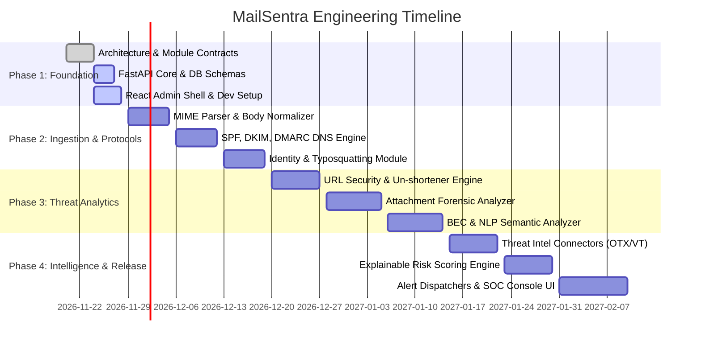

# MailSentra Engineering Roadmap

## Overview

The development of MailSentra is structured into four disciplined, sequential phases. This phased approach guarantees architectural integrity, thorough unit testing, and production-grade stability at every stage.

---

## Phase Breakdown

---

### Phase 1: Technical Foundation (Current Scope)
- [x] High-level architectural specification and component boundaries.
- [x] Technology selection and evaluation matrix.
- [x] Modular project directory structure separating security modules from API/DB layers.
- [x] Foundational documentation: `README.md`, `ARCHITECTURE.md`, `TECH_STACK.md`, `SECURITY_DESIGN.md`, `DEVELOPMENT_ROADMAP.md`.
- [x] Initial backend setup: FastAPI application, Pydantic v2 schemas, configuration management, SQLite/PostgreSQL async engine.
- [x] Strongly typed module data contracts (`contracts.py`) defining interfaces for all 13 modules.
- [x] Initial frontend setup: React 18 + TypeScript + Vite project shell with Tailwind CSS.
- [x] Health check endpoints, API routing structure, and Pytest verification suite.

### Phase 2: Core Parsing, Identity & Protocol Verification (Next Scope)
- [ ] **Email Ingestion Module**: RFC 5322 EML file upload, raw MIME byte stream handling, and payload size bounds.
- [ ] **Email Parsing & Normalization Module**: Multi-part MIME decoding, RFC 2047 header normalization, body text extraction, HTML stripping, defanged link extraction.
- [ ] **Authentication Protocols Module**: Asynchronous DNS query engine for SPF validation, DKIM signature verification, and DMARC alignment/policy calculation.
- [ ] **Sender Identity Verification Module**: Display name spoofing detection, executive impersonation rules, Levenshtein distance typosquatting engine, and Punycode/IDN analysis.
- [ ] Test harness for RFC-compliant test emails and real-world spoofing test cases.

### Phase 3: Payload & Behavioral Threat Analytics
- [ ] **URL Security Module**: URL canonicalization, redirect following, IP-host detection, suspicious TLD categorization, and zero-width character detection.
- [ ] **Attachment Security Module**: File magic byte identification (countering double extensions), SHA-256 hash calculation, Office document macro detection, and archive structure inspection.
- [ ] **Social Engineering & BEC Module**: Linguistic intent modeling, financial wire transfer heuristics, payroll modification prompts, and urgent call-to-action indicators.

### Phase 4: Intelligence Enrichment, Risk Scoring & SOC Experience
- [ ] **Threat Intelligence Module**: Integration connectors for AbuseIPDB, VirusTotal, and AlienVault OTX with multi-level LRU/database caching.
- [ ] **Risk Scoring Engine**: Multi-vector Bayesian/weighted scoring algorithm producing normalized threat scores (0–100) with explainable rationale trees.
- [ ] **Alert & Notification Module**: Syslog (RFC 5424), Webhook, Slack, and Microsoft Teams dispatchers.
- [ ] **Admin Dashboard**: Full SOC triage interface with email deep-dive inspector, header hop visualizer, and audit log reviewer.
- [ ] End-to-end integration test suite and containerized Docker deployment.
