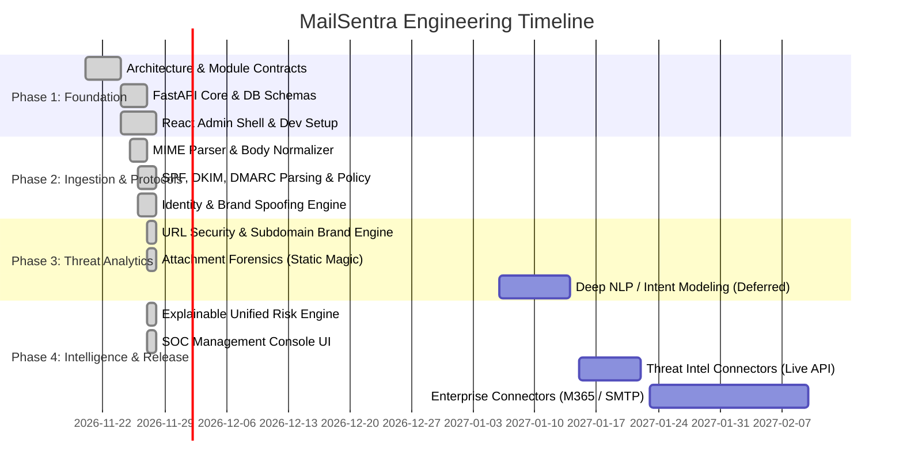

# MailSentra Engineering Roadmap

## Overview

The development of MailSentra is structured into four sequential phases. This phased approach guarantees architectural integrity, thorough unit testing, and production-grade stability at every stage.

---

## Phase Breakdown & Current Status

---

### Phase 1: Technical Foundation (Completed)
- [x] High-level architectural specification and component boundaries (`ARCHITECTURE.md`).
- [x] Technology selection and evaluation matrix (`TECH_STACK.md`).
- [x] Modular project directory structure separating security modules from API/DB layers.
- [x] Foundational documentation: `README.md`, `ARCHITECTURE.md`, `TECH_STACK.md`, `SECURITY_DESIGN.md`, `DEVELOPMENT_ROADMAP.md`.
- [x] Backend runtime: FastAPI application, Pydantic v2 schemas, configuration management, SQLite/PostgreSQL async engine.
- [x] Strongly typed module data contracts (`contracts.py`) defining interfaces across analytical modules.
- [x] Frontend shell: React 18 + TypeScript + Vite project with Tailwind CSS.
- [x] Health check endpoints, API routing structure, and automated Pytest verification suite.

### Phase 2: Core Parsing, Identity & Protocol Verification (Completed)
- [x] **Email Ingestion Module**: RFC 5322 EML file upload, raw MIME byte stream handling, and payload size bounds (`ScanService`).
- [x] **Email Parsing & Normalization Module**: Multi-part MIME decoding, RFC 2047 header normalization, safe body text extraction, script decomposition, and defanged link extraction (`app/modules/parser/`).
- [x] **Authentication Protocols Module**: Local parser for `Authentication-Results` / `Received-SPF` headers, offline tree-walking, and fail-safe DMARC policy evaluation (`app/modules/auth_protocols/`). *(Note: Direct file uploads without live MTA transport telemetry evaluate under safe `INDETERMINATE` defaults).*
- [x] **Sender Identity Verification Module**: Structural RFC 5322 header integrity analysis (`MALFORMED_SENDER_ADDRESS`, duplicate headers), protected brand display-name impersonation (17 enterprise profiles), Levenshtein cousin-domain detection, and Punycode/IDN homoglyph normalization (`app/modules/identity/`).
- [x] **Regression Test Harness**: Test suite covering real-world synthetic emails (`backend/tests/fixtures/real_world_emails/`) and automated regression suites.

### Phase 3: Payload & Behavioral Threat Analytics (Partially Implemented / Active Baseline)
- [x] **URL Security Module (Static Analysis)**: URL canonicalization, defanging, IP-host detection, suspicious TLD categorization, and Public Suffix List (PSL)-aware Subdomain Brand Impersonation detection (`app/modules/url_analysis/`).
- [ ] **URL Redirect & Un-shortening Engine (Live Network)**: Automated redirect following and un-shortening over live HTTP connections *(Deferred to preserve air-gapped/offline isolation)*.
- [x] **Attachment Security Module (Static Forensics)**: In-memory pure-Python file magic byte identification (DOS/MZ, PE, ELF, Mach-O, PDF, ZIP/OpenXML), double extension detection (`.xlsx.exe`), SHA-256 calculation, macro presence heuristics, and archive traversal bounds checking (`app/modules/attachment_analysis/`).
- [ ] **Dynamic Sandbox Detonation**: Automated execution and behavioural detonation of attachments in a virtualized guest VM *(Planned enterprise enhancement)*.
- [x] **Social Engineering & Header Mismatch Detection**: Structural header discrepancies (`FROM_REPLYTO_MISMATCH`, `FROM_RETURN_PATH_MISMATCH`) and display-name spoofing signals.
- [ ] **Deep NLP Semantic Intent Modeling**: Computational linguistics intent classification, financial coercion scoring, and LLM embedding analysis *(Planned Phase 3 continuation)*.

### Phase 4: Intelligence Enrichment, Risk Scoring & SOC Experience
- [x] **Explainable Risk Engine**: Unified multi-vector scoring engine with deterministic tier boundaries (`CLEAN`, `SUSPICIOUS`, `MALICIOUS`), Priority 1/2/3 signal integration, cross-analyzer brand deduplication, and failure isolation (`app/modules/risk_engine/`).
- [x] **Admin & SOC Dashboard**: React 18 + Vite triage interface with email parsing inspector, attachment forensics card, extracted URL grid, and audit record viewer.
- [ ] **Live Threat Intelligence Feeds**: Production API connectors for VirusTotal, AbuseIPDB, and AlienVault OTX *(Planned; credential-gated)*.
- [ ] **External Alert Dispatchers**: Live production dispatchers for Webhooks, RFC 5424 Syslog, Slack, and Microsoft Teams *(Data schemas and mock dispatchers implemented; live endpoints planned)*.
- [ ] **Enterprise Ingestion Connectors**: SMTP milter relay and Microsoft 365 / Google Workspace Graph API listeners *(Planned future work)*.
- [x] **End-to-End Test Suite**: 878 passing automated unit and integration tests across all modules.
