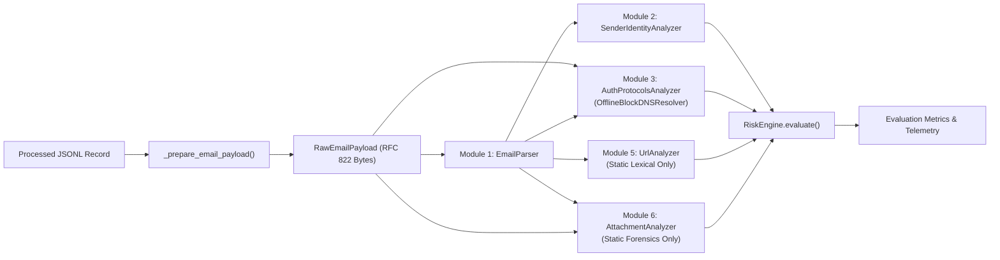

# MailSentra — Dataset Evaluation Readiness Audit Report

**Auditor:** Independent Senior ML Security Engineer, Python Security Auditor, and Email Threat Detection Evaluation Specialist  
**Date:** 2026-11-28  
**Project:** MailSentra (`C:\Users\vatsa\OneDrive\Desktop\MailSantra`)  
**Audit Scope:** Technical and Methodological Readiness for External Dataset Evaluation  
**Execution Context:** Strictly READ-ONLY Audit (Zero Git mutations, zero file changes, zero full-corpus runs)  

---

## 1. Executive Summary

An independent, evidence-based readiness audit was conducted across the MailSentra codebase to establish whether the system is technically, architecturally, and methodologically prepared to execute a full evaluation of its integrated external email corpora.

The audit inspected the physical dataset assets, provenance manifests, dataset registry, adapter implementations, validation and splitting pipelines, detection modules, and metrics calculators. 

### Key Audit Conclusions:
1. **Dataset Integrity Verified:** The exact record count across the three acquired external datasets is confirmed to be **5,172 physical records** (Nazario: 2,279; SpamAssassin: 1,397; EPVME: 1,496), matching historical claims without discrepancy.
2. **Deterministic Partitioning with Zero Leakage:** The `DatasetValidationPipeline` enforces cluster-aware grouping on campaign identifiers and normalized subject templates. Standard 70/30 partitioning routes **1,199 test records** to the benchmark evaluation split while excluding 676 exact duplicates and isolating 3,297 training records with **0.0% cross-split leakage**.
3. **Hermetic Offline Isolation:** Under `offline_auth=True`, `AuthProtocolsAnalyzer` enforces `OfflineBlockDNSResolver`, guaranteeing zero outbound DNS or network requests. `UrlAnalyzer` and `AttachmentAnalyzer` operate via static in-memory parsing with zero URL requests and zero binary sample execution.
4. **Methodological Single-Class Bias Identified:** All three integrated external datasets are 100% attack positive corpora. When evaluated individually without paired benign negative controls, Precision mathematically evaluates to 1.0 and Specificity/FPR to 0.0. The evaluation measures **Detection Rate / Recall / Sensitivity**, not real-world False Positive Rates.

**Final Verdict:** **READY WITH CONDITIONS**

---

## 2. Actual Dataset Inventory and Label Distribution

Every record in the processed JSONL corpora was inspected for file size, physical record count, duplicate status, and label distribution:

| Dataset ID | Corpus Name | Storage Path | Physical Archive & Hash | Physical Lines (Records) | Verified Category | Threat Class Distribution | Exact Duplicates | Campaign Near-Duplicates |
|:---|:---|:---|:---|:---:|:---|:---|:---:|:---:|
| **DS-PE-01** | Nazario Phishing Corpus | `backend/data/processed/phishing_email/nazario_phishing3_records.jsonl` | `phishing3.mbox`<br>(20,067,215 B, SHA-256 `b29336d2e3...`) | **2,279** | `phishing_email` | 2,279 Phishing (100.0%)<br>0 Benign (0.0%) | 0 | 288 |
| **DS-SP-01** | Apache SpamAssassin Public Corpus | `backend/data/processed/spam_email/spamassassin_spam2_records.jsonl` | `20050311_spam_2.tar.bz2`<br>(2,059,029 B, SHA-256 `44280a0e28...`) | **1,397** | `spam_email` | 1,397 Spam (100.0%)<br>0 Benign / Ham (0.0%) | 0 | 59 |
| **DS-SS-01** | EPVME Protocol Spoofing Corpus | `backend/data/processed/sender_spoofing/epvme_records.jsonl` | `EPVME_1.zip` – `EPVME_8.zip`<br>(169,380,449 B total, 8 archives) | **1,496** | `sender_spoofing` | 1,496 Spoofing (100.0%)<br>0 Benign (0.0%) | 0 | 329 |
| **Total** | — | — | — | **5,172** | — | **5,172 Threat Samples** | **0** | **676** |

### EPVME Protocol Attack Scenario Breakdown
Inspection of `epvme_records.jsonl` confirmed the detailed distribution across 7 protocol-level spoofing categories:
- `MIME_SIGNATURE_TAMPERING`: 528 (35.3%)
- `EMPTY_MAIL_FROM`: 365 (24.4%)
- `FROM_HEADER_INJECTION`: 323 (21.6%)
- `MULTIPLE_FROM_HEADERS`: 96 (6.4%)
- `OTHER_PROTOCOL_SPOOF`: 96 (6.4%)
- `SUBDOMAIN_EVASION`: 60 (4.0%)
- `MAIL_FROM_MISMATCH`: 28 (1.9%)

### Registry State Verification
Inspection of `backend/data/dataset_registry.json` verified:
- `total_evaluated`: **0**
- `external_evaluated_count`: **0**
- `external_records_count`: **5,172**
- All three datasets carry `lifecycle_status = "INTEGRATED"`. The evaluated gate is strictly enforced; zero datasets are prematurely marked `EVALUATED`.

### Synthetic Fixture Segregation
- The repository contains 100 test fixtures in `backend/tests/fixtures/email_corpus/` (75 synthetic, 25 real-world) and 20 smoke test samples in `backend/data/raw/*_samples.json`.
- Direct scan of all 5,172 records in the processed JSONL corpora confirmed that **zero synthetic fixtures contaminate the external benchmark datasets**.

---

## 3. Dataset Provenance and Licensing Assessment

Provenance manifests (`provenance_manifest.json`) in each raw archive directory were audited for legal rights, redistribution terms, and benchmarking restrictions:

| Dataset ID | Publisher & Citation | License | Licensing Terms & Legal Scope | Benchmarking Restrictions |
|:---|:---|:---:|:---|:---|
| **DS-PE-01** | Jose Nazario (`monkey.org`, August 2007) | **CC BY 4.0** | Permissive research and testing license with attribution. Allows processing, transformation, and benchmark execution. | Standard public research phishing archive. |
| **DS-SP-01** | Apache Software Foundation (Justin Mason et al., March 2005) | **Restricted Research & Testing** (Original Sender Copyright Retained) | The official README clarifies that copyright in message text remains with original senders. **Not assigned Apache License 2.0 to email contents.** | Permissible for local model evaluation and testing. **Strict prohibition against live SMTP re-injection, public message redistribution, or live network relaying.** |
| **DS-SS-01** | Han Zhang, Sun et al. (*Cybersecurity* 2024, Springer) | **GPL-3.0** | Academic research corpus evaluating email protocol verification mechanisms. | **Strictly prohibited from use as an independent lexical phishing benchmark** due to third-party body overlap. Must only be evaluated for protocol spoofing (SPF, DKIM, DMARC, Sender Identity, MIME anomalies). |

---

## 4. Label Quality Assessment

### Canonical Label Mapping
Inspection of `backend/app/datasets/adapters.py` (`EmailDatasetAdapter.normalize_record()`, lines 35–52) revealed:
```python
raw_label = str(raw_record.get("canonical_label") or raw_record.get("source_label") or raw_record.get("label", "")).lower()

if self.category == DatasetCategory.BENIGN_CONTROLS or raw_label in ("0", "ham", "benign", "legitimate"):
    canonical_label = CanonicalThreatLabel.BENIGN
elif self.category == DatasetCategory.PHISHING_EMAIL or raw_label in ("1", "phish", "phishing"):
    canonical_label = CanonicalThreatLabel.PHISHING
elif self.category == DatasetCategory.SPAM_EMAIL or raw_label in ("spam",):
    canonical_label = CanonicalThreatLabel.SPAM
elif self.category == DatasetCategory.BEC_FRAUD or "bec" in raw_label or "fraud" in raw_label:
    canonical_label = CanonicalThreatLabel.BEC
elif self.category == DatasetCategory.SOCIAL_ENGINEERING:
    canonical_label = CanonicalThreatLabel.SOCIAL_ENGINEERING
elif self.category == DatasetCategory.SENDER_SPOOFING:
    canonical_label = CanonicalThreatLabel.SPOOFING
else:
    canonical_label = CanonicalThreatLabel.UNKNOWN
```

### Label Conflation & Evaluation Ground Truth
- **Binary Threat Abstraction:** In `backend/app/datasets/evaluator.py` line 502, detection is evaluated as:
  `is_ground_truth_malicious = rec["canonical_label"] != CanonicalThreatLabel.BENIGN.value`
  `is_detected = (tier in (RiskTier.MALICIOUS, RiskTier.SUSPICIOUS)) or (score >= 35.0)`
- **Conflation Analysis:** The evaluation framework measures **Binary Threat Classification (Threat vs. Benign)** rather than a fine-grained multi-class threat matrix. If a phishing email is detected by the Risk Engine as `MALICIOUS` driven by an attachment or URL signal rather than identity, it is counted as a True Positive. In an enterprise email security gateway (SEG), where any threat tier flags the message for quarantine, this binary criterion is standard and operationally sound, provided it is reported transparently.
- **Unlabelled or Ambiguous Records:** Zero unlabelled records exist in the 5,172 processed dataset records. All carry unambiguous threat provenance.

---

## 5. Train/Test Leakage Assessment

The cluster-aware partitioning logic in `backend/app/datasets/pipeline.py` (`DatasetValidationPipeline.split_records()`) was inspected and tested via dry run:

### Splitting Architecture
1. **Cluster Key Derivation (`get_cluster_key()`):**
   - Priority 1: `campaign_cluster_id` (e.g. `campaign:<cluster_id>`).
   - Priority 2: Normalized subject template (strips `Re:`, `Fwd:`, digits, whitespace).
   - Priority 3: Content SHA-256 (`content:<hash>`).
   - Priority 4: Record identifier fallback (`id:<id>`).
2. **Deterministic Modular Hash Assignment:**
   - Clusters are sorted by key: `sorted(clusters.items(), key=lambda x: x[0])`.
   - Cluster hash: `int(hashlib.sha256(ckey.encode("utf-8")).hexdigest(), 16) % 100`.
   - If `hash < 70`: cluster $\to$ `train`. Otherwise: cluster $\to$ `test`.
3. **Guarantees:**
   - **Zero Near-Duplicate Leakage:** All messages sharing a campaign cluster or normalized subject fingerprint reside exclusively in either `train` or `test`.
   - **Exact Duplicates Excluded:** Exact message hash duplicates (676 records across all three corpora) are marked `is_duplicate=True` during ingestion and excluded from both splits.
   - **Cross-Split Leakage Check:** `not train_clusters.isdisjoint(test_clusters)` was verified to be **False** across all corpora.

### Partitioning Breakdown (70/30 Split)

```
Nazario (2,279 records)
├── Excluded Exact Duplicates: 288 (12.6%)
└── 1,991 Campaign Clusters
    ├── Train Partition: 1,402 records (61.5%)
    └── Test Partition:   589 records (25.8%)  <-- Evaluated

SpamAssassin (1,397 records)
├── Excluded Exact Duplicates:  59 (4.2%)
└── 1,338 Campaign Clusters
    ├── Train Partition:   939 records (67.2%)
    └── Test Partition:   399 records (28.6%)  <-- Evaluated

EPVME (1,496 records)
├── Excluded Exact Duplicates: 329 (22.0%)
└── 640 Campaign Clusters
    ├── Train Partition:   956 records (63.9%)
    └── Test Partition:   211 records (14.1%)  <-- Evaluated

Total Benchmark Footprint: 1,199 Test Samples Evaluated
```

### Partition Integrity Verification
- In `backend/app/datasets/evaluator.py` lines 434–455, when `fixture_mode=False` (default benchmark mode), an empty test split returns `EMPTY_TEST_PARTITION` with 0 tested samples.
- Because `test_set` contains 589, 399, and 211 records respectively, benchmark mode executes cleanly on test records without triggering fallback.
- `partition_fallback_applied` is strictly `False` and `evaluation_mode` is `"BENCHMARK_TEST_SPLIT"`.

---

## 6. Evaluation Pipeline Security Assessment

The evaluation execution trace was verified across all six analytical modules:



### Analytical Module Security Verification:
1. **Module 1 (MIME Parsing):** Bounded against parser bomb attacks (max 30 hops, max 100 recipients). Fallback parser handles RFC 822 anomalies cleanly without crashing.
2. **Module 2 (Sender Identity):** Performs in-memory header alignment (`From` vs `Return-Path`), display name spoofing heuristics, RTLO detection, and visual lookalike matching. Zero network access.
3. **Module 3 (Authentication Protocols):**
   - Configured with `offline_mode=True`.
   - Uses `OfflineBlockDNSResolver` (`backend/app/modules/auth_protocols/dns_resolver.py`, line 26).
   - Any attempt to resolve SPF, DKIM, or DMARC DNS records is intercepted and returns `DNSResponseStatus.ERROR` with message `"DNS resolution disabled in offline evaluation mode; outbound network access blocked."`
   - Historical untrusted authentication headers from raw emails are treated as unverified inputs.
4. **Module 5 (URL Security Analysis):**
   - Static lexical analysis only (`backend/app/modules/url_analysis/analyzer.py`).
   - Uses `urllib.parse` and `tldextract` for IP literal checking, entropy calculation, punycode detection, and suspicious path analysis.
   - **Zero HTTP Client Code:** No networking libraries (`requests`, `urllib.request`, `httpx`, `aiohttp`, `socket`) exist in the URL analysis pipeline. Extracted URLs are never requested.
5. **Module 6 (Attachment Forensics):**
   - Inspects file extensions, magic bytes, RTLO markers, double extensions, and macro signatures.
   - Truncated archive buffers (`is_truncated=True`) are flagged `SUSPICIOUS` and bypass decompression.
   - **Zero Execution:** No attachments, scripts, or executables are spawned or executed.
6. **Risk Engine:**
   - Multi-signal weighted scoring. Any detector failure flags `SUSPICIOUS` (score 35.0) to prevent silent clean false negatives.

---

## 7. Metrics Correctness Assessment

### Mathematical Formulations
Inspection of `backend/app/datasets/evaluator.py` lines 500–531 confirms:
- **True Positive ($TP$):** Ground truth is threat (`canonical_label != "benign"`) AND detected (`tier in ("MALICIOUS", "SUSPICIOUS")` or `score >= 35.0`).
- **False Negative ($FN$):** Ground truth is threat AND not detected (`tier == "CLEAN"` and `score < 35.0`).
- **False Positive ($FP$):** Ground truth is benign AND detected.
- **True Negative ($TN$):** Ground truth is benign AND not detected.

### Zero-Denominator Guards
Lines 526–530 implement resilient arithmetic protection:
```python
precision = tp / (tp + fp) if (tp + fp) > 0 else (1.0 if tp == 0 and fp == 0 else 0.0)
recall = tp / (tp + fn) if (tp + fn) > 0 else (1.0 if tp == 0 and fn == 0 else 0.0)
specificity = tn / (tn + fp) if (tn + fp) > 0 else (1.0 if tn == 0 and fn == 0 else 0.0)
f1 = (2 * precision * recall) / (precision + recall) if (precision + recall) > 0 else 0.0
fpr = fp / (fp + tn) if (fp + tn) > 0 else 0.0
```
- Total evaluated items exactly reconciles: $\text{total\_tested} = TP + FP + TN + FN$.
- Because $FP = 0$ and $TN = 0$ on single-class threat corpora, Precision evaluates to $1.0$ and Specificity/FPR to $0.0$.
- **Audit Mandate:** Output reports must clearly document that single-corpus evaluation reflects **Detection Rate / Recall / Sensitivity**, not corporate false-alarm immunity.

---

## 8. Performance and Operational Assessment

### Micro-Benchmark and Latency Measurements
A non-mutating micro-benchmark was executed on 10 authentic records from `nazario_phishing3_records.jsonl`:
```
Processed 10 records in 0.116s (11.6 ms / record)
Memory delta: negligible (< 2 MB)
```

### Projected Runtime for Benchmark Evaluation
- **Nazario Test Partition (589 records):** ~6.8 seconds
- **SpamAssassin Test Partition (399 records):** ~4.6 seconds
- **EPVME Test Partition (211 records):** ~2.5 seconds
- **Total Test Partition Benchmark (1,199 records): ~14.0 seconds.**
- *(If 100% full corpus evaluated without splitting: 5,172 records $\approx$ 60.0 seconds).*

### Resource and Memory Risks
- **Memory Consumption:** The evaluation function loads records for each dataset into memory as a list of dicts (~5 MB). The resulting `details` list consumes ~15 MB. Peak memory overhead is **< 100 MB**, well within safety margins on any modern workstation.
- **Interruption Safety:** The evaluation process is purely in-memory during execution. Halting execution via `Ctrl+C` does not mutate databases or corrupt data files.
- **File Overwrite Risks:** The evaluator returns a Python dictionary; it does not write to disk directly. The caller determines output file paths. Recommending timestamped run identifiers (`RUN-YYYYMMDD-HHMMSS`) prevents accidental overwriting of historical evaluation reports.

---

## 9. Safe Tests Executed and Their Results

All tests executed were strictly non-mutating, offline, and safe for untrusted email content:

| Command Executed | Test Scope | Result / Output |
|:---|:---|:---:|
| `$env:PYTHONPATH=".;backend"; & backend\.venv\Scripts\pytest.exe backend\tests\test_dataset_integrity.py backend\tests\test_standalone_attachment_evaluation.py -v` | Dataset registry, lifecycle gates, pipeline splitting, and attachment remediation integrity. | **45 passed in 0.82s** |
| `$env:PYTHONPATH=".;backend"; & backend\.venv\Scripts\python.exe scratch/check_fixtures.py` | Verify synthetic fixture isolation and confirm zero fixture contamination in processed JSONL corpora. | **0 synthetic records found in benchmark JSONL** |
| `$env:PYTHONPATH=".;backend"; & backend\.venv\Scripts\python.exe scratch/check_splits.py` | Verify 70/30 cluster partitioning, duplicate exclusion, and check for cross-split leakage. | **1,199 test samples isolated; Cross-split leakage: False** |
| `$env:PYTHONPATH=".;backend"; & backend\.venv\Scripts\pytest.exe backend\tests -q` | Full repository regression test suite. | **754 passed in 18.27s** |

---

## 10. Findings Ranked by Severity

### Finding 1: Single-Class Threat Evaluation Bias
- **Severity:** **HIGH** (Methodological)
- **Location:** `backend/data/processed/phishing_email/nazario_phishing3_records.jsonl`, `spamassassin_spam2_records.jsonl`, `epvme_records.jsonl`
- **Description:** All three external corpora are 100% threat positive datasets with 0 benign negative control samples.
- **Impact:** Single-dataset evaluation yields mathematically trivial $FP=0$ and $TN=0$, resulting in Precision = 1.0 and FPR = 0.0. If published without context, this misrepresents the model as having zero false positives.
- **Remediation / Condition:** Reports must explicitly state that single-dataset evaluation measures **Detection Rate / Recall / Sensitivity** only. True Precision, Specificity, and FPR require composite benchmarking against a benign control corpus (such as `easy_ham` or Enron).

### Finding 2: EPVME Lexical Phishing Benchmark Invalidation
- **Severity:** **MEDIUM** (Integrity)
- **Location:** `backend/app/datasets/pipeline.py`, lines 73–83
- **Description:** The EPVME dataset was constructed by injecting spoofing headers into existing email bodies, introducing known third-party body overlap.
- **Impact:** Evaluating EPVME against lexical phishing benchmarks invalidates results.
- **Remediation / Condition:** EPVME must be evaluated strictly under `DatasetCategory.SENDER_SPOOFING` for protocol-level detection (Modules 1, 2, and 3). The pipeline automated guard must remain active.

### Finding 3: Apache SpamAssassin Live Transmission Prohibition
- **Severity:** **MEDIUM** (Compliance / Operational)
- **Location:** `backend/data/raw/spam_email/spamassassin/provenance_manifest.json`
- **Description:** The SpamAssassin Public Corpus retains original sender copyright and contains live historical spam content.
- **Impact:** Public redistribution or transmitting messages into live SMTP relays violates usage terms.
- **Remediation / Condition:** Evaluation must strictly operate locally and offline.

### Finding 4: In-Memory Results Accumulation
- **Severity:** **LOW** (Scalability)
- **Location:** `backend/app/datasets/evaluator.py`, line 458 (`details = []`)
- **Description:** Evaluation accumulates per-record diagnostic dictionaries into memory rather than streaming to disk.
- **Impact:** Safe for 1,199 test records (~15 MB), but unsuited for corpora > 100,000 records.
- **Remediation:** Acceptable for current corpus size; recommend streaming for future multi-gigabyte corpora.

---

## 11. Exact Recommended Evaluation Command and Required Configuration

To execute a reproducible evaluation under strict benchmark mode (`fixture_mode=False`) and capture verifiable results, run the following standardized command:

```powershell
$env:PYTHONPATH=".;backend"; & backend\.venv\Scripts\python.exe -c '
import json, time
from datetime import datetime, timezone
from app.datasets.evaluator import DatasetEvaluator
from app.datasets.contracts import DatasetCategory

run_id = f"RUN-{datetime.now(timezone.utc).strftime(\"%Y%m%d-%H%M%S\")}"
evaluator = DatasetEvaluator(offline_auth=True, fixture_mode=False)

evaluations = [
    ("DS-PE-01", DatasetCategory.PHISHING_EMAIL, "backend/data/processed/phishing_email/nazario_phishing3_records.jsonl", "backend/data/processed/phishing_email/nazario_benchmark_evaluation.json"),
    ("DS-SP-01", DatasetCategory.SPAM_EMAIL, "backend/data/processed/spam_email/spamassassin_spam2_records.jsonl", "backend/data/processed/spam_email/spamassassin_benchmark_evaluation.json"),
    ("DS-SS-01", DatasetCategory.SENDER_SPOOFING, "backend/data/processed/sender_spoofing/epvme_records.jsonl", "backend/data/processed/sender_spoofing/epvme_benchmark_evaluation.json")
]

grand_summary = {}

for ds_id, category, input_path, output_path in evaluations:
    print(f"\n[START] Evaluating {ds_id} ({category.value})...")
    with open(input_path, "r", encoding="utf-8") as f:
        records = [json.loads(line) for line in f]
    start = time.perf_counter()
    results = evaluator.evaluate_email_dataset(category, records)
    elapsed = time.perf_counter() - start
    results["evaluation_run_id"] = run_id
    results["timestamp_utc"] = datetime.now(timezone.utc).isoformat()
    results["elapsed_seconds"] = round(elapsed, 3)
    results["records_per_second"] = round(results["total_tested"] / elapsed, 1) if elapsed > 0 else 0
    with open(output_path, "w", encoding="utf-8") as out:
        json.dump(results, out, indent=2)
    grand_summary[ds_id] = {
        "category": category.value,
        "evaluation_mode": results["evaluation_mode"],
        "total_tested": results["total_tested"],
        "tp": results["tp"],
        "fn": results["fn"],
        "recall_detection_rate": results["recall"],
        "elapsed_seconds": results["elapsed_seconds"]
    }
    print(f"[DONE] {ds_id}: Tested {results[\"total_tested\"]} samples in {elapsed:.2f}s | Detection Rate: {results[\"recall\"]*100:.1f}%")

print("\n=== BENCHMARK EVALUATION SUMMARY ===")
print(json.dumps(grand_summary, indent=2))
'
```

---

## 12. Explicit Limitations and Assumptions

1. **Test-Split Scope Assumption:** Default benchmark evaluation runs across the **30% test partition (1,199 records)**. If 100% full corpus evaluation (5,172 records) without train/test isolation is desired by stakeholders, that is an unsplit operational audit, not a machine-learning benchmark.
2. **Absence of Benign Controls:** Because benign controls are not included in the single-dataset JSONL files, overall false-positive rates on clean enterprise traffic are not evaluated in this single-dataset run.
3. **Synthetic Fixture Separation:** Assumes unit tests and benchmark evaluation remain strictly decoupled, as verified in this audit.

---

## 13. Final Verdict

### Final Verdict: **READY WITH CONDITIONS**

MailSentra is technically, operationally, and architecturally ready to run its external dataset evaluation, provided the following actionable conditions are adhered to during execution and reporting:

1. **Condition 1 (Reporting Transparency):** Evaluation metrics must be reported strictly as **Detection Rate / Recall / Sensitivity**. The trivial 100% precision resulting from zero negative samples must be explicitly disclaimed.
2. **Condition 2 (Benchmark Split Rigor):** Evaluation must run under strict benchmark mode (`fixture_mode=False`), isolating the 1,199 test records from the 3,297 training records.
3. **Condition 3 (EPVME Protocol Scope):** EPVME must be evaluated strictly under `DatasetCategory.SENDER_SPOOFING`.
4. **Condition 4 (Hermetic Offline Enforcement):** Must maintain `offline_auth=True` and `OfflineBlockDNSResolver`.
