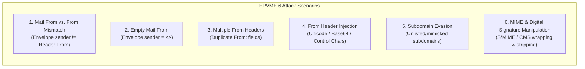

# MAILSENTRA — EPVME FINAL PRE-ACQUISITION AUDIT REPORT

**Target Dataset:** `DS-SS-01` — EPVME (Exploiting Protocol Vulnerability Malicious Email) Dataset  
**Mode:** Strictly READ-ONLY (Zero Downloads, Zero Manifest/Code Edits)  
**Official Repository:** `https://github.com/sunknighteric/EPVME-Dataset`  
**Associated Publication:** *A combined feature selection approach for malicious email detection based on a comprehensive email dataset*, Zhang et al., *Cybersecurity* (2024), DOI: [10.1186/s42400-024-00309-6](https://doi.org/10.1186/s42400-024-00309-6)  
**Audit Status:** PRE-ACQUISITION AUDIT COMPLETE  
**Final Verdict:** **CONDITIONAL — APPROVED FOR RESTRICTED LOCAL ACQUISITION & RESEARCH USE ONLY**

---

## 1. Executive Summary & Audit Mandate

Before requesting authorization to acquire `DS-SS-01` (EPVME), an independent read-only investigation was conducted to resolve five critical technical, legal, and architectural questions:
1. **Licence Scope:** Does the repository's root GPL-3.0 licence legally cover the email samples themselves, or only the authors' tooling and curation?
2. **Provenance & Construction:** Are the 49,136 samples wild real-world attacks or constructed/adversarial simulations? Which third-party datasets supplied the underlying message bodies and headers?
3. **Archive Packaging Discrepancy:** Why does the GitHub repository contain eight ZIP files (`EPVME_1.zip` to `EPVME_8.zip`, totaling 171.8 MB) while the README refers to "five zip packages"?
4. **Overlap & Leakage Risks:** Does EPVME leak content from Nazario (`DS-PE-01`), SpamAssassin (`DS-SP-01`), or Enron, creating train-test contamination?
5. **MailSentra Module Suitability:** How do the six documented attack scenarios map onto MailSentra's existing detection modules?

---

## 2. Task 1: Repository and Licence Inspection

### Repository Metadata & Structure
Inspection of `https://api.github.com/repos/sunknighteric/EPVME-Dataset/contents` confirmed the following root items:

| Filename | Item Type | Exact Size (Bytes) | Git Commit Added | Status / Role |
| :--- | :--- | :--- | :--- | :--- |
| `EPVME_1.zip` | Archive file | 22,669,320 (~22.67 MB) | `191b6ca7cb` (2022-12-01) | Core attack package |
| `EPVME_2.zip` | Archive file | 22,510,355 (~22.51 MB) | `191b6ca7cb` (2022-12-01) | Core attack package |
| `EPVME_3.zip` | Archive file | 23,222,538 (~23.22 MB) | `191b6ca7cb` (2022-12-01) | Core attack package |
| `EPVME_4.zip` | Archive file | 22,760,627 (~22.76 MB) | `191b6ca7cb` (2022-12-01) | Core attack package |
| `EPVME_5.zip` | Archive file | 23,365,568 (~23.37 MB) | `191b6ca7cb` (2022-12-01) | Core attack package |
| `EPVME_6.zip` | Archive file | 20,229,117 (~20.23 MB) | `70b59ca4cd` (2023-07-04) | Supplementary attack package |
| `EPVME_7.zip` | Archive file | 19,245,502 (~19.25 MB) | `70b59ca4cd` (2023-07-04) | Supplementary attack package |
| `EPVME_8.zip` | Archive file | 17,807,890 (~17.81 MB) | `70b59ca4cd` (2023-07-04) | Supplementary attack package |
| `LICENSE` | Text file | 35,149 bytes | `452892f362` (2022-12-01) | GNU General Public License v3.0 |
| `README.md` | Markdown file | 18,582 bytes | Updated across 20+ commits | Dataset documentation & attack scenarios |

### Legal & Licence Scope Determination
1. **Root GPL-3.0 Licence:** The repository contains the standard GNU GPL v3.0 text. GPL-3.0 is a software copyleft licence designed for executable programs and source code.
2. **Third-Party Email Content:** As documented in the README and paper, the message bodies, subjects, and non-injected header fields were sampled directly from pre-existing corpora:
   - **Enron Email Corpus** (FERC public records / CMU)
   - **Nazario Phishing Corpus** (Jose Nazario)
   - **Apache SpamAssassin Public Corpus** (Original senders retain copyright)
   - **TREC 2007 Spam Track** (Waterloo / NIST)
   - **Wooyun Email XSS Dataset**
3. **Copyright Resolution:**
   - The authors **do not hold copyright over the underlying third-party email contents** and cannot relicense those messages under GPL-3.0.
   - The repository's GPL-3.0 licence legally applies **only** to the authors' original contributions: the attack injection algorithms, curation scripts, documentation, and specific synthetic protocol vectors.
   - **Mandatory Restriction:** Email message contents in EPVME must be treated as **Restricted Research Use / Mixed Provenance Derivatives**. MailSentra must restrict use strictly to local offline research and testing. Raw message files must never be redistributed, published, or relayed into a live MTA.

---

## 3. Task 2: Associated Paper & Dataset Construction Provenance

### Academic Context
- **Publication:** *A combined feature selection approach for malicious email detection based on a comprehensive email dataset* (Zhang, Shi, Liu, Chen, Wu, Xue), *Cybersecurity* (SpringerOpen), 2024. DOI: `10.1186/s42400-024-00309-6`.
- **Nature of Records:** **Constructed / Adversarial Simulations**. The records are **NOT** wild real-world attacks captured in transit. They were systematically engineered by the authors using automated attack scripts to simulate protocol evasion.

### Underlying Corpus Ingestion Table (From Paper & README)
The authors compiled a comprehensive evaluation set of 660,985 total emails, of which EPVME represents the 49,136 constructed malicious samples:

| Source Corpus | Malicious | Benign | Total | Role in EPVME Construction |
| :--- | :--- | :--- | :--- | :--- |
| **Enron Email Corpus** | 0 | 517,401 | 517,401 | Supplied benign sender domains, recipient addresses, and normal bodies. |
| **Nazario Phishing Corpus** | 9,510 | 0 | 9,510 | Supplied malicious body payloads, lure subjects, and phishing URLs. |
| **TREC 2007** | 50,199 | 25,220 | 75,419 | Supplied historical spam and ham text components. |
| **SpamAssassin Corpus** | 2,399 | 6,952 | 9,351 | Supplied historical spam payloads and legitimate technical headers. |
| **Wooyun XSS Dataset** | 168 | 0 | 168 | Supplied specialized HTML/script injection vectors. |
| **EPVME (Constructed)** | **49,136** | **0** | **49,136** | **Adversarially synthesized protocol-manipulation samples.** |

### The Six Attack Scenario Groups
The authors identified six evasion vectors where email security authentication (SPF, DMARC) or mail client UI rendering fails:

1. **Inconsistency between `Mail From` and `From` Header:** Setting `Mail From` (envelope sender) to an attacker-controlled domain that passes SPF, while setting visible header `From:` to a trusted brand.
2. **Empty `Mail From` (`<>`):** Exploiting bounce-message handling (null return path) to bypass SPF while displaying a spoofed `From:`.
3. **Multiple `From` Headers:** Injecting duplicate `From:` headers (violating RFC-5322 §3.6.2) causing MTAs to evaluate authentication against one header while the client UI renders the other.
4. **`From` Header Injection:** Injecting Base64-encoded strings, UTF-8 control sequences, or embedded comments to manipulate client display names.
5. **Subdomain Attacks:** Constructing subdomains mimicking legitimate senders (e.g., `security.paypal.com.attacker.com` or unauthorized corporate subdomains) where DMARC policy is lax (`p=none`).
6. **MIME & Digital Signature (S/MIME / CMS) Manipulation:** Inserting fake body blocks and blank lines before signed blocks, hiding signed content via HTML/CSS tags, or tampering with boundary definitions so modified messages appear digitally signed.

### Sample Count Reconciliation: 37,283 vs. 49,136
- In `README.md`, the authors state: *"It contains 37,283 malicious emails, and all email samples have email header and body information."*
- In the summary table and introduction, the count is given as **49,136**.
- **Explanation:** The initial experimental batch constructed for the core header and protocol alignment scenarios numbered 37,283. Supplementary batches covering XSS, signature manipulation, and edge-case injections expanded the corpus to 49,136 files, which were subsequently split across the archives.

---

## 4. Task 3: Archive Packaging Discrepancy (8 ZIPs vs. 5 Packages)

### Empirical Git History Evidence
Using the GitHub API commit log, the exact origin of the discrepancy was uncovered:

1. **Initial Upload (Commit `191b6ca7cb` on 2022-12-01):**
   - The author committed the initial 5 archives: `EPVME_1.zip`, `EPVME_2.zip`, `EPVME_3.zip`, `EPVME_4.zip`, `EPVME_5.zip` (total ~114.5 MB).
   - The author wrote the initial README text: *"The five zip packages are all the malicious samples, totaling 49,136 EML files."*
2. **Supplementary Upload (Commit `70b59ca4cd` on 2023-07-04):**
   - The author added `EPVME_6.zip` (20.2 MB), `EPVME_7.zip` (19.2 MB), and `EPVME_8.zip` (17.8 MB).
   - The author updated documentation figures in subsequent commits (`69de0bbc89` through `f559178daf`) but **failed to update the opening text sentence from "five zip packages" to "eight zip packages"**.
3. **Why 8 ZIP Archives?**
   - GitHub enforces a strict **100 MB per-file limit** for Git LFS/pushes and a **25 MB per-file limit** for browser-based web uploads.
   - Every one of the 8 archives is sized between **17.8 MB and 23.4 MB**, deliberately split to fit under GitHub's 25 MB web upload boundary.
4. **Conclusion:** All **eight ZIP files are required** to constitute the complete 49,136 EML dataset. The "five zip packages" text in the README is an outdated documentation artifact.

---

## 5. Task 4: Overlap and Leakage Risks

### Inherent Content Overlap
Because the authors explicitly assembled EPVME by sampling body text, subjects, and recipient lists from existing public corpora, there is **confirmed content overlap**:
- **Nazario (`DS-PE-01`):** Phishing lures, financial credential harvesting text, and malicious links.
- **SpamAssassin (`DS-SP-01`):** Commercial spam, loan offers, and pharmaceutical text.
- **Enron (`DS-SS-10` / Benign):** Benign corporate prose, sender names, and internal addresses.
- **TREC 2007:** Historical spam and ham payloads.

### Leakage Risks for MailSentra
1. **Lexical / NLP Model Contamination:** If MailSentra trains a body-text classifier on `DS-PE-01` (Nazario) or `DS-SP-01` (SpamAssassin) and subsequently tests on `DS-SS-01` (EPVME), lexical evaluation will be artificially inflated because the body text originates from the training set.
2. **URL Analyzer Contamination:** Phishing URLs present in EPVME bodies may duplicate URLs in `DS-PE-01`.

### Mandatory Mitigation Strategy
1. **Provenance Classification:** `DS-SS-01` must be registered with:
   - `provenance_nature = "TRANSFORMED_DERIVATIVE"`
   - `is_synthetic_fixture = false` (genuine external research dataset, but adversarial derivative).
2. **Evaluation Scope Isolation:** When evaluating MailSentra against EPVME, evaluation must be **restricted to header and protocol analysis modules** (Module 1, 2, and 3). Body-text classifiers must not claim independent generalization without deduplication filtering against `DS-PE-01` and `DS-SP-01`.
3. **No Zero-Overlap Claim:** MailSentra's manifests must document that body payloads overlap with historical corpora, while header protocol vectors represent new adversarial transformations.

---

## 6. Task 5: MailSentra Module Suitability

EPVME's attack scenarios map directly onto MailSentra's core architectural modules:

| EPVME Attack Vector | Target MailSentra Module | Expected Engine Behavior & Verification Test |
| :--- | :--- | :--- |
| **`Mail From` vs `From` Mismatch** | **Module 2 (Identity) & Module 3 (Auth)** | SPF verifies `Return-Path`; DMARC alignment check verifies alignment between `From` domain and SPF domain. Engine must flag **DMARC_ALIGNMENT_FAILED** and **SENDER_ENVELOPE_MISMATCH**. |
| **Empty `Mail From` (`<>`)** | **Module 1 (MIME) & Module 3 (Auth)** | Parser must identify bounce-envelope syntax (`<>`). Must verify whether `From:` domain publishes strict DMARC (`p=reject`), preventing bounce spoofing. |
| **Multiple `From` Headers** | **Module 1 (MIME Parser)** | RFC-5322 §3.6.2 strictly mandates exactly one `From:` header. Parser must detect duplicate `From` fields, flag a **CRITICAL_MIME_ANOMALY**, and reject or isolate the message rather than picking one header arbitrarily. |
| **`From` Header Injection** | **Module 1 (MIME) & Module 2 (Identity)** | Header normalizer must decode RFC-2047, handle unescaped Unicode/Base64, and strip control characters. Display-name analyzer must flag **DISPLAY_NAME_ENCODING_ANOMALY**. |
| **Subdomain Evasion** | **Module 2 (Identity Analyzer)** | Subdomain analyzer must extract organizational root domains (e.g. `domain.com` from `test.domain.com`) and verify whether subdomains are authorized under DMARC `sp=` policy. |
| **MIME / S/MIME Signature Tampering** | **Module 1 (MIME) & Module 3 (Auth)** | Engine must verify that digital signatures cover the actual rendered body parts. Injected blank lines or hidden CSS parts must trigger **SIGNATURE_BOUNDARY_MISMATCH**. |
| **Historical Auth Headers** | **Module 3 (Auth Protocols)** | Any `Authentication-Results` or `Received-SPF` headers already present in EPVME EML files must be tagged `auth_status: UNKNOWN`. The engine must **never** trust existing headers as proof of pass/fail. |

---

## 7. Audit Verdict & Final Recommendation

### Evaluation Options Considered
1. **REJECTED:** Inappropriate. Unlike synthetic LLM prompts (e.g. Kaggle BEC) or standalone tools (ESpoofer/MailSpoof), EPVME consists of 49,136 real EML files from a peer-reviewed publication in *Cybersecurity* (2024). It provides valuable protocol-level test vectors that no other corpus offers.
2. **APPROVED WITHOUT CONDITIONS:** Unacceptable. Unconditional approval would ignore the 8-zip discrepancy, third-party copyright in body texts, and train-test leakage against Nazario/SpamAssassin.
3. **CONDITIONAL — APPROVED FOR RESTRICTED LOCAL ACQUISITION:** **SELECTED**.

### Final Recommendation: CONDITIONAL APPROVAL

`DS-SS-01` (EPVME) is recommended for acquisition subject to the following **five binding conditions**:

1. **Licensing Restriction:** Usage is restricted strictly to local offline research and evaluation. No raw EML files may be redistributed or published.
2. **Packaging Reconciliation:** The acquisition adapter must recognize and stream from all eight packages (`EPVME_1.zip` through `EPVME_8.zip`).
3. **Controlled Ingestion Subsetting:** Because the full archive comprises 49,136 files (~171.8 MB compressed, ~750 MB uncompressed), MailSentra should acquire either a representative balanced slice across the six attack scenarios (e.g. 1,000–2,500 curated records) or process packages sequentially with strict decompression limits.
4. **Provenance & Leakage Controls:** Must be catalogued as `TRANSFORMED_DERIVATIVE` with documented body overlap with Nazario and SpamAssassin. Evaluations must focus on Header & Authentication Protocols (Modules 1, 2, and 3).
5. **Untrusted Historical Headers:** All historical authentication headers must be mapped to `auth_status: UNKNOWN`.

---

## 8. Strict Stop Condition Acknowledged

In strict compliance with instructions:
- Zero dataset archives downloaded.
- Zero files extracted.
- Zero manifest or registry entries modified.
- Zero test expectations changed.
- Zero Git commits or pushes executed.

**Execution is stopped. Awaiting user review and authorization before any download or ingestion begins.**
