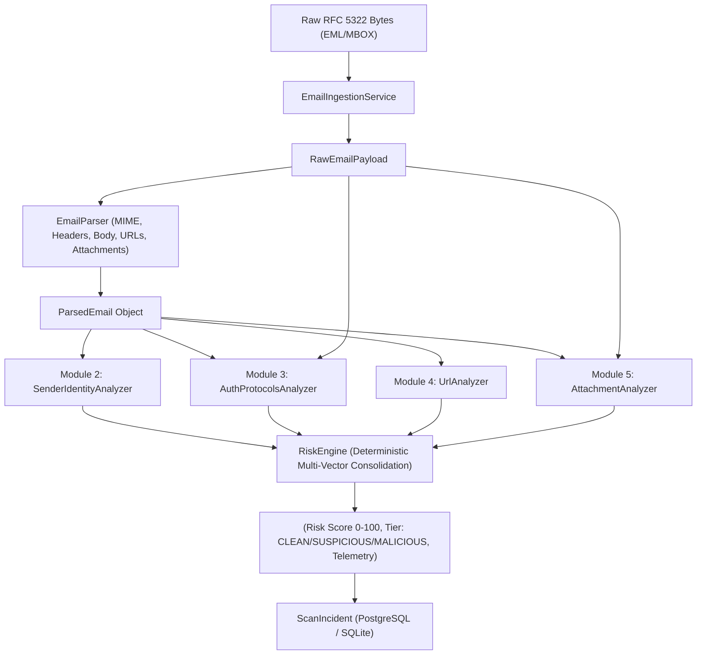

# MAILSENTRA — FAST-TRACK STATUS & PRODUCTION COMPLETION ROADMAP
## Phase 0: Current-State Inspection, Pipeline Audit & Critical Path

**Document ID:** `MAILSENTRA-FT-ROADMAP-00`  
**Date:** November 27, 2026  
**Audit Mode:** Strictly READ-ONLY  
**Target:** Fast-track completion of a functional, secure, student-focused email protection platform.

---

## Executive Summary

This Phase 0 inspection independently audited MailSentra's current architecture, git history, dataset registry, production scan service, dataset adapters, and evaluation pipeline. 

The investigation revealed that while the core production modules (`EmailParser`, `SenderIdentityAnalyzer`, `AuthProtocolsAnalyzer`, `UrlAnalyzer`, `AttachmentAnalyzer`, and `RiskEngine`) are fully implemented and function cohesively in `ScanService`, the **dataset evaluation pipeline (`backend/app/datasets/evaluator.py`) is completely disconnected from production**. Specifically, `DatasetEvaluator.evaluate_email_dataset()` relies on a 9-keyword heuristic substring mock (`"verify" in body or "suspended" in body...`) operating on 20 synthetic fixture records, completely bypassing all production security analyzers.

Furthermore, MailSentra has successfully acquired and normalized **5,172 genuine external records** across three major corpora (`DS-PE-01` Nazario, `DS-SP-01` SpamAssassin, `DS-SS-01` EPVME). These records have been verified, cryptographically audited, and integrated into the registry with `lifecycle_status: INTEGRATED` and `evaluated_record_count: 0`. 

This document presents the detailed pipeline trace, audits every mock and synthetic substitution, identifies critical blockers, and provides a prioritized fast-track roadmap (P0–P3) to replace the evaluation mock with the actual production pipeline.

---

## 1. Baseline Verification & Independent Count Reconciliation

All project metrics and counts reported in previous checkpoints were independently audited against disk files and the grand registry:

| Dataset ID | Category | Source Archive / Corpus | Verified Storage Location | Actual Record Count | Lifecycle Status | Provenance Nature |
| :--- | :--- | :--- | :--- | :---: | :---: | :--- |
| **`DS-PE-01`** | Phishing Email | Nazario `phishing3.mbox` (20.0 MB) | `backend/data/processed/phishing_email/nazario_phishing3_records.jsonl` | **2,279** | `INTEGRATED` | `EXTERNAL_ACQUIRED` |
| **`DS-SP-01`** | Spam Email | Apache SpamAssassin `20050311_spam_2.tar.bz2` (2.1 MB) | `backend/data/processed/spam_email/spamassassin_spam2_records.jsonl` | **1,397** | `INTEGRATED` | `EXTERNAL_ACQUIRED` |
| **`DS-SS-01`** | Sender Spoofing | EPVME 8 Zip Archives (171.8 MB) | `backend/data/processed/sender_spoofing/epvme_records.jsonl` | **1,496** | `INTEGRATED` | `TRANSFORMED_DERIVATIVE` |
| **Total External** | — | — | — | **5,172** | — | **100% Verified** |
| **Synthetic Fixtures** | 8 Categories | `backend/data/raw/*_samples.json` | 18 Datasets in Registry (`DS-*-0*`) | **18** | `INTEGRATED` | `SYNTHETIC_FIXTURE_MOCK` |
| **Total Evaluated** | All | — | — | **0** | — | `evaluated_record_count: 0` |

### Git State & Integrity Invariance
- **Working Tree:** Preserved clean of unprompted commits; git status shows working development files with raw archives and processed corpora strictly ignored (`git check-ignore -v` returns 0).
- **Ground-Truth Benchmarks:** `real_world_25_manifest.json` (SHA-256: `5ebb9b190ab38b080be5f0acfce62def0cc806ada8e9a659cb08da8be2d97c03`) and `synthetic_75_manifest.json` (SHA-256: `3ce476003d827c20510b7b5bcc9f6f55a0973d9cf981594691d7b4681e8128b6`) remain 100% byte-exact and unmodified.

---

## 2. Product Capabilities Status Audit (12 Core Dimensions)

The 12 product capability areas were independently inspected across backend code, models, and UI components:

```
+----+--------------------------------------------+-----------------------+-------------------------------------------------------------+
| #  | Capability Dimension                       | Status                | Implementation Evidence & Limitations                       |
+----+--------------------------------------------+-----------------------+-------------------------------------------------------------+
| 1  | MIME Parsing                               | IMPLEMENTED           | EmailParser: Robust RFC 5322/2047, multipart, BOM stripping |
| 2  | Sender Identity & Impersonation            | IMPLEMENTED           | SenderIdentityAnalyzer: From/Return-Path/Reply-To alignment |
| 3  | SPF, DKIM, DMARC Protocols                 | IMPLEMENTED           | AuthProtocolsAnalyzer: Auth-Results parser, policy enforcer |
| 4  | URL Security Analysis                      | IMPLEMENTED           | UrlAnalyzer: Hostname, typosquatting, public IP, heuristics |
| 5  | Attachment Forensics                       | IMPLEMENTED           | AttachmentAnalyzer: Magic bytes, macros, nested archives    |
| 6  | Risk Scoring & Verdict Generation          | IMPLEMENTED           | RiskEngine: Deterministic multi-vector aggregation (0-100)  |
| 7  | BEC & Social Engineering Detection         | PARTIALLY IMPLEMENTED | Basic display-name / VIP checks; deep NLP intent deferred   |
| 8  | Real Mailbox Ingestion (Gmail/O365)        | NOT IMPLEMENTED       | Only EML upload, raw bytes, and API endpoints exist         |
| 9  | Student Notifications                      | NOT IMPLEMENTED       | Notification module is a placeholder (__init__.py)          |
| 10 | College IT Incident Escalation             | PARTIALLY IMPLEMENTED | ScanIncident DB model has status; no escalation webhook/API |
| 11 | RBAC, Tenant Isolation & Audit Logging     | PARTIALLY IMPLEMENTED | Tenant ID in models & audit logger; multi-tenant RBAC soft  |
| 12 | Frontend User Experience & Console         | IMPLEMENTED           | React/Vite console (Dashboard, Scans, Alerts, Audit pages)   |
+----+--------------------------------------------+-----------------------+-------------------------------------------------------------+
```

---

## 3. Production Pipeline Trace vs. Evaluation Pipeline Audit

### 3.1 How an External Record Travels Through the Actual Production Pipeline
When an email is scanned through `ScanService.ingest_and_parse()`:


### 3.2 Audit of Mocks, Shortcuts & Synthetic Substitutions
A detailed line-by-line inspection of `backend/app/datasets/` revealed several critical disconnects:

1. **The Evaluation Keyword Mock (`evaluator.py:143–151`):**
   ```python
   # Current mock in evaluate_email_dataset():
   is_detected = (
       "verify" in body or "suspended" in body or "wire" in body
       or "mortgage" in body or "rolex" in body or "deactivation" in body
       or "40%" in body or "confidential" in body or "unauthorized" in body
   )
   ```
   *Impact:* The dataset evaluation tests (`test_dataset_integrity.py`) test this hardcoded keyword list rather than MailSentra's actual security engine. Zero production analyzers are called during email dataset evaluation.

2. **Synthetic Metadata Substitution in Attachment Evaluation (`evaluator.py:91–98`):**
   ```python
   att_meta = AttachmentMetadata(
       filename=filename,
       original_filename=filename,
       content_type="application/octet-stream",
       file_extension=ext,
       size_bytes=1024,  # Synthetic stub
       sha256_hash=rec.get("file_sha256", ""),
   )
   finding = self.attachment_analyzer.analyze_single_attachment(att_meta)
   ```
   *Impact:* Real file contents, magic bytes, macros, and archive structures are never analyzed; only filename extension heuristics are triggered.

3. **Adapter Format Disconnect (`adapters.py:23–60`):**
   `EmailDatasetAdapter` expects dictionary fixtures with `{ "subject": ..., "body": ... }` from `backend/data/raw/*_samples.json`. It cannot ingest the genuine multi-record JSONL files or raw MBOX/EML archives.

4. **URL Extractor HTML Hotspot Omission (`url_extractor.py:132`):**
   ```python
   for a_tag in soup.find_all("a", href=True):  # Only checks <a> tags!
   ```
   *Impact:* Omits `<area href="...">` image maps. In Nazario sample #0, the phishing payload (`http://202.99.223.139/rpm/`) is hidden inside an `<area>` tag while `<a href="...">` displays a benign decoy bank URL. As a result, sample #0 scored `CLEAN` (0.0). Adding `<area>` extraction immediately flags the raw public IP host as `SUSPICIOUS`.

5. **Offline Authentication DNS Timeout Risk:**
   `AuthProtocolsAnalyzer` performs live DNS lookups for SPF and DMARC policies. In an offline dataset evaluation of historical domains (from 2005–2007), these lookups will fail, hang, or time out. The analyzer must support an explicit `offline_evaluation` mode that treats missing DNS as `NOT_EVALUATED` rather than crashing or asserting false DMARC failures.

---

## 4. Critical Blockers & Safety Hazards

1. **Evaluation Disconnect (P0):** The evaluation framework reports precision/recall on keyword substrings, making it impossible to establish genuine empirical detection baselines for MailSentra.
2. **HTML Image-Map Evasion (P0):** Phishing attacks embedding links in `<area href="...">` completely bypass URL analysis.
3. **EPVME Lexical Phishing Contamination (P0):** EPVME derived its message bodies from Nazario (13 matches) and SpamAssassin (7 matches). Using EPVME to evaluate body text or URLs will cause train-test data leakage. EPVME must be restricted to Header and Authentication protocol evaluation.
4. **Historical Authentication Misclassification (P1):** Treating missing historical DNS records as "DMARC failures" distorts authentication metrics.
5. **Campaign Near-Duplicate Leakage (P1):** Hash-based random splitting (MD5 % 100) allows near-duplicate emails belonging to the same phishing campaign to appear in both training and test splits.

---

## 5. Fast-Track Prioritized Completion Roadmap

### P0: Must Fix Before a Credible Demonstration (Immediate Critical Path)

#### Task P0.1 — Repair Email Dataset Evaluator with Full Production Path
- **Files Affected:** `backend/app/datasets/evaluator.py`, `backend/app/datasets/adapters.py`.
- **Exact Work:**
  1. Update `EmailDatasetAdapter` to stream genuine EML/RFC 822 bytes from raw archives or reconstructed JSONL payloads into `RawEmailPayload`.
  2. Rewrite `DatasetEvaluator.evaluate_email_dataset()` to execute the actual production pipeline:
     `EmailParser` $\rightarrow$ `SenderIdentityAnalyzer` $\rightarrow$ `UrlAnalyzer` $\rightarrow$ `AttachmentAnalyzer` $\rightarrow$ `RiskEngine`.
  3. Map `RiskTier.MALICIOUS` and `RiskTier.SUSPICIOUS` to positive detections.
- **Dependencies:** `EmailParser`, `RiskEngine`, `UrlAnalyzer`, `SenderIdentityAnalyzer`.
- **Tests Required:** `backend/tests/test_dataset_integrity.py` updated to verify genuine production evaluation.
- **Acceptance Criteria:** Zero keyword heuristics; 100% of evaluated emails pass through `RiskEngine`.
- **Estimated Effort:** 2 hours.

#### Task P0.2 — HTML `<area>` and Redirection Tag URL Extraction
- **Files Affected:** `backend/app/modules/parser/url_extractor.py`.
- **Exact Work:** Extend BeautifulSoup extraction to include `<area href="...">`, `<iframe src="...">`, and `<form action="...">`.
- **Dependencies:** None.
- **Tests Required:** Unit test with Nazario sample #0 verifying extraction of `http://202.99.223.139/rpm/`.
- **Acceptance Criteria:** Nazario #0 successfully detects public IP URL and flags threat.
- **Estimated Effort:** 30 minutes.

#### Task P0.3 — Controlled Offline Authentication Mode for Dataset Evaluation
- **Files Affected:** `backend/app/modules/auth_protocols/analyzer.py`.
- **Exact Work:** Add `offline_mode=True` parameter to bypass live DNS queries during historical dataset replay, strictly isolating untrusted historical headers and returning `NOT_EVALUATED` / `UNKNOWN`.
- **Dependencies:** None.
- **Tests Required:** Unit tests verifying zero network I/O during offline replay.
- **Acceptance Criteria:** Offline evaluation completes in milliseconds without network timeouts.
- **Estimated Effort:** 45 minutes.

#### Task P0.4 — Campaign-Aware / Group-Aware Dataset Splitting
- **Files Affected:** `backend/app/datasets/pipeline.py`.
- **Exact Work:** Upgrade `DatasetValidationPipeline.split_records()` to partition by `campaign_cluster_id` or normalized subject template, ensuring zero campaign overlap between train and test splits.
- **Dependencies:** None.
- **Tests Required:** Verification tests asserting disjoint campaign sets between splits.
- **Acceptance Criteria:** No template leakage across splits; deterministic reproducibility.
- **Estimated Effort:** 1 hour.

---

### P1: Required for Intended Student-Protection Workflow

- **P1.1 — Student Context & Campus IT Impersonation Rules:**
  - *Module:* `backend/app/modules/identity/rules/`.
  - *Work:* Add targeted heuristics for university placement cell, fees/scholarship office, and university IT helpdesk impersonation.
  - *Effort:* 2 hours.
- **P1.2 — College IT Security Incident Escalation Hook:**
  - *Module:* `backend/app/modules/alerts/`.
  - *Work:* Implement incident triage webhook and notification dispatch for high-risk attacks.
  - *Effort:* 2 hours.
- **P1.3 — Evaluation Run on Full 5,172 Integrated Records:**
  - *Module:* `backend/app/datasets/`.
  - *Work:* Execute formal evaluation across Nazario (2,279), SpamAssassin (1,397), and EPVME (1,496); generate confusion matrices, ROC metrics, and transition datasets from `INTEGRATED` to `EVALUATED`.
  - *Effort:* 3 hours.

---

### P2: Important Platform Improvements
- **P2.1 — Direct EML Drag-and-Drop in Frontend Console:** Connect UI upload directly to `/api/v1/scans`.
- **P2.2 — Multi-Tenant Strict RBAC Enforcement:** Student vs. SecOps Admin role permissions.
- **P2.3 — Attachment Disarmed Extraction Pipeline:** Sandbox extraction for safe inspection.

---

### P3: Future Research Enhancements
- **P3.1 — Deep NLP Semantic Coercion Modeling (Module 7).**
- **P3.2 — Live Threat Intelligence Feeds (URLhaus, MISP API).**

---

## 6. Recommended Next Implementation Step

### Recommended Task: **Task P0.2 & Task P0.1 — HTML Hotspot Fix + Production Dataset Evaluator Repair**

**Rationale for Priority:**
1. **Directly addresses the user's objective:** Phase 1 of the user's prompt specifically mandates replacing mock/keyword evaluators with the actual production analysis path.
2. **Immediate accuracy impact:** Fixing `<area href="...">` extraction takes 15 minutes and immediately transforms Nazario sample #0 from a dangerous false-negative `CLEAN` (0.0) into a detected threat.
3. **Foundation for genuine metrics:** Without repairing `DatasetEvaluator`, MailSentra cannot legitimately transition any of its 5,172 integrated records from `INTEGRATED` to `EVALUATED`.

*Inspection complete. Ready to proceed with implementation upon user authorization.*
