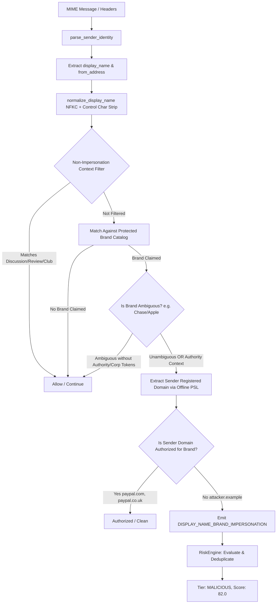

# MailSentra — Priority 3: Display-Name Brand Impersonation Detection Report

**Document ID:** `MAILSENTRA-P3-REP-01`  
**Task Type:** Focused Security-Engineering Implementation & Verification  
**Priority:** P3  
**Status:** Completed & Fully Validated  
**Date:** November 28, 2026  
**System:** MailSentra Threat Detection Platform (Modules 3 & 9)  

---

## Executive Summary

During historical benchmark evaluations (e.g. Nazario and SpamAssassin phishing corpora), a significant subset of false negatives arose from **Display-Name Brand Impersonation**. In these attacks, malicious senders manipulate the user-visible display name (e.g., `"PayPal Security Team"`, `"Microsoft Account Support"`, `"Amazon Billing"`) to masquerade as trusted organizations, while transmitting the email from an arbitrary attacker-controlled domain (e.g., `security@attacker.example`). Because standard email authentication protocols (SPF, DKIM, DMARC) validate only the envelope (`Return-Path`) or RFC 5322 `From:` domain, display name deception completely bypasses domain-level cryptographic verification.

To address this vector, MailSentra's **Sender Identity Analyzer** (`backend/app/modules/identity/`) has been augmented with a dedicated, deterministic detection layer (**Rule 4: Display-Name Brand Impersonation**). This layer cross-references claimed brand identities against an offline public suffix-aware catalog of authorized domains. When brand deception is identified without legitimate domain authorization, `SenderIdentityAnalyzer` emits a high-severity finding `DISPLAY_NAME_BRAND_IMPERSONATION`. The **RiskEngine** (`backend/app/modules/risk_engine/engine.py`) has been upgraded to recognize this signal, classify the message as `MALICIOUS` (base score 80.0, net score 82.0), and deduplicate with the URL analyzer's subdomain brand impersonator to avoid redundant double-counting of the same underlying brand claim.

All 60 newly implemented regression tests and all 211 combined identity, URL, and risk engine tests pass cleanly with zero external API/DNS dependencies.

---

## 1. Problem Definition & Threat Model

### 1.1 The Attack Vector
Display-name spoofing is one of the most prevalent techniques in targeted phishing and Business Email Compromise (BEC). Attackers exploit user interface behavior in modern email clients:
1. **Mobile and Web UI Abstraction:** Modern mail user agents (MUAs) prominently display the friendly display name (`"PayPal Support"`) while truncating or obscuring the technical address (`support@malicious-domain.com`).
2. **Authentication Protocol Blind Spots:**
   - **SPF:** Evaluates the RFC 5321 `Mail From` (envelope sender) against publishing DNS records. An attacker sending from their own domain (`attacker.example`) passes SPF.
   - **DKIM:** Cryptographically validates that the body and specific headers were signed by the domain specified in the `d=` tag. An attacker signing with `d=attacker.example` passes DKIM.
   - **DMARC:** Requires alignment between the RFC 5322 `From:` domain and the SPF/DKIM domains. An attacker with aligned headers on `attacker.example` satisfies DMARC.
   - **Result:** None of these standards inspect the semantic contents of the display name for brand impersonation.

### 1.2 Threat Scenarios
- **Credential Harvesting:** Display name `"Microsoft Account Security"`, actual sender `alert@login-verification.top`.
- **Financial Phishing:** Display name `"PayPal Billing Department"`, actual sender `receipt@invoice-server.xyz`.
- **E-Commerce Fraud:** Display name `"Amazon Order Confirmation"`, actual sender `shipment@track-status.click`.
- **Banking Fraud:** Display name `"Chase Online Banking"`, actual sender `notice@account-audit.biz`.

---

## 2. Architecture & Detection Logic

### 2.1 Placement in the Pipeline
The capability is implemented directly inside `check_display_name()` within [display_name.py](file:///c:/Users/vatsa/OneDrive/Desktop/MailSantra/backend/app/modules/identity/rules/display_name.py#L290-L335), extending MailSentra's existing Identity Analysis module. It operates after structural header checks and address-in-display-name spoofing checks.



### 2.2 Normalized Input Processing
Display names frequently contain obfuscation techniques designed to evade simple regex matching:
- **Unicode Canonical Normalization:** All inputs undergo `unicodedata.normalize("NFKC", display_name)` to collapse compatibility characters and full-width representations.
- **Invisible & Control Character Stripping:** Zero-width spaces (`\u200B`), non-breaking spaces, zero-width joiners (`\u200C`, `\u200D`), and control characters are stripped.
- **Bounding & Stripping:** Leading/trailing quotes, apostrophes, and brackets are stripped. Display names exceeding 255 characters are truncated safely to avoid ReDoS or algorithmic complexity attacks.

### 2.3 Brand Matching & Catalog Representation
In [config.py](file:///c:/Users/vatsa/OneDrive/Desktop/MailSantra/backend/app/modules/identity/config.py#L38-L135), the `ProtectedBrand` model and `DEFAULT_PROTECTED_BRANDS` catalog define protected brand profiles:

```python
class ProtectedBrand(BaseModel):
    name: str
    variations: List[str] = Field(default_factory=list)
    domains: List[str] = Field(default_factory=list)
    allowed_subdomains: List[str] = Field(default_factory=list)
    is_ambiguous: bool = False
```

#### High-Value Brand Catalog (17 Enterprise Brands)
| Brand Name | Variations / Aliases | Authorized Primary Domains | Ambiguous? |
|:---|:---|:---|:---:|
| **PayPal** | `paypal`, `pay pal` | `paypal.com`, `paypal-communication.com` | No |
| **Microsoft** | `microsoft`, `office365`, `office 365`, `microsoft365` | `microsoft.com`, `office.com`, `live.com`, `outlook.com` | No |
| **Amazon** | `amazon`, `amazon web services`, `aws` | `amazon.com`, `amazonaws.com` | No |
| **Apple** | `apple`, `icloud` | `apple.com`, `icloud.com` | Yes |
| **eBay** | `ebay`, `e-bay` | `ebay.com` | No |
| **Chase** | `chase`, `chase bank`, `jpmorgan chase` | `chase.com`, `jpmorgan.com`, `jpmorganchase.com` | Yes |
| **Wells Fargo** | `wells fargo`, `wellsfargo` | `wellsfargo.com` | No |
| **Bank of America**| `bank of america`, `bofa` | `bankofamerica.com`, `bofa.com` | No |
| **Citi** | `citibank`, `citi` | `citi.com`, `citigroup.com`, `citibank.com` | No |
| **Netflix** | `netflix` | `netflix.com` | No |
| **Google** | `google`, `google cloud`, `google support` | `google.com`, `gmail.com` | No |
| **Facebook** | `facebook`, `meta` | `facebook.com`, `meta.com`, `facebookmail.com` | No |
| **Instagram** | `instagram` | `instagram.com` | No |
| **LinkedIn** | `linkedin` | `linkedin.com` | No |
| **Dropbox** | `dropbox` | `dropbox.com`, `dropboxmail.com` | No |
| **Yahoo** | `yahoo` | `yahoo.com` | No |
| **National City** | `national city`, `national city bank` | `nationalcity.com` | No |

### 2.4 Domain Authorization via Public Suffix List (PSL)
Domain verification is conducted using MailSentra's offline public suffix parser (`_OFFLINE_EXTRACTOR` via `tldextract` with bundled suffix data):
1. **Registered Domain Extraction:** Given `support@mail.sub.attacker.example`, the registered domain is extracted as `attacker.example`.
2. **Authorized Domain Matching:** The extracted registered domain is checked against the brand's authorized domains list.
3. **ccTLD Stem Matching:** For global brands with localized ccTLDs (e.g. `paypal.co.uk`, `amazon.de`, `ebay.fr`), if the registered domain stem matches the brand's primary domain stem (e.g. `paypal` == `paypal`), authorization is recognized.
4. **Legitimate Subdomain Support:** Domains like `e.paypal.com` resolve to registered domain `paypal.com` and are recognized as authorized.

---

## 3. False-Positive Safeguards

To prevent legitimate business communications and common English vocabulary from triggering false alarms, multiple safeguard mechanisms are built into the detection pipeline:

### 3.1 Ambiguous Brand Filtering (`is_ambiguous = True`)
Certain brand names are homonyms for common nouns or personal names:
- **`Chase`:** A common given name (`"Chase Miller"`, `"Chase Crawford"`).
- **`Apple`:** A common noun and occasional name (`"Fiona Apple"`, `"Apple Orchards"`).

**Safeguard Rule:**
When `is_ambiguous=True`, matching requires either:
1. An exact standalone match (e.g. display name is exactly `"Chase"` or `"Apple"`), OR
2. Presence of a corporate or authority marker (e.g., `"Bank"`, `"Online"`, `"Card"`, `"Support"`, `"Security"`, `"Service"`, `"Corp"`, `"Inc"`, `"Mobile"`).
*Result:* `"Chase Miller"` -> Ignored (CLEAN). `"Chase Bank Support"` -> Flagged if domain is unauthorized.

### 3.2 Non-Impersonation Context Filters
Legitimate emails frequently mention brands in review contexts, community discussions, or fan clubs:
- **Prefixes:** `review of`, `discussion about`, `unboxing`, `thoughts on`.
- **Suffixes:** `fan club`, `reviewers club`, `users group`, `discussion group`, `community forum`.
*Result:* `"Review of Amazon Products"` -> Safely excluded. `"Amazon Reviewers Club"` -> Safely excluded.

### 3.3 Neutrality on Unknown External Senders
Regular external correspondents who do not assert protected brand names in their display names (e.g., `"John Doe <john@personal-site.org>"`) produce zero identity findings and evaluate as `RiskTier.CLEAN` (score 0.0).

---

## 4. RiskEngine Integration & Deduplication

### 4.1 Scoring & Tier Promotion
In [engine.py](file:///c:/Users/vatsa/OneDrive/Desktop/MailSantra/backend/app/modules/risk_engine/engine.py#L180-L245), `DISPLAY_NAME_BRAND_IMPERSONATION` is classified as a severe impersonation indicator:
- **Baseline Tier Promotion:** The presence of `DISPLAY_NAME_BRAND_IMPERSONATION` marks `is_malicious = True`, sets `base_score = max(base_score, 80.0)`, and promotes the tier to `RiskTier.MALICIOUS`.
- **Corroborating Signal Count:** As an active signal, it contributes to the final corroborating signal weight (+2.0 points), resulting in an individual score of **82.0 / 100.0**.
- **Explanation Generation:** The risk engine surfaces the finding clearly:  
  `"THREAT DETECTED (MALICIOUS). Corroborating signals: [IDENTITY-IMPERSONATION] DISPLAY_NAME_BRAND_IMPERSONATION: Display name 'PayPal Security Team' claims protected brand 'PayPal' but sender domain 'attacker.example' is not an authorized domain for this brand."`

### 4.2 Cross-Analyzer Deduplication
An attacker may craft an email that features both:
1. Subdomain brand impersonation in a URL (e.g., `https://paypal.com.evil-phish.net/login`), and
2. Display-name brand impersonation in the headers (`"PayPal Support <attacker@evil-phish.net>"`).

Both signals point to the same underlying deception: impersonating PayPal. To avoid artificially inflating the risk score through redundant counting of the same brand threat, `RiskEngine.evaluate()` tracks `impersonated_brands_seen`:
- When `SUBDOMAIN_BRAND_IMPERSONATION` fires on brand `'paypal'`, it is recorded.
- When `DISPLAY_NAME_BRAND_IMPERSONATION` subsequently fires on brand `'paypal'`, it is recognized as a duplicate brand claim and its corroborating signal count is deduplicated.
- If the email impersonates two *different* brands (e.g. display name claims `"Microsoft Support"` while a URL impersonates `"paypal.com"`), both are counted.

---

## 5. Verification & Test Suite Results

A dedicated test suite was created in [test_display_name_brand_impersonation.py](file:///c:/Users/vatsa/OneDrive/Desktop/MailSantra/backend/tests/test_display_name_brand_impersonation.py). All tests pass deterministically.

### 5.1 Test Coverage Summary (60 Tests)
```
============================== test session starts ==============================
platform win32 -- Python 3.13.7, pytest-8.3.4, pluggy-1.5.0
rootdir: C:\Users\vatsa\OneDrive\Desktop\MailSantra\backend
configfile: pyproject.toml
plugins: anyio-4.8.0, asyncio-0.25.3, cov-6.0.0
asyncio: mode=Mode.STRICT
collected 60 items

backend\tests\test_display_name_brand_impersonation.py ............................................................ [100%]

============================== 60 passed in 0.51s ===============================
```

### 5.2 Verification Matrix
| Test Class / Category | Scope & Invariants Tested | Result |
|:---|:---|:---:|
| `TestDisplayNameBrandImpersonationDetection` | Core brand impersonation on PayPal, Microsoft, Amazon, eBay, Chase Bank, Wells Fargo, Netflix, Apple Support | **10 / 10 PASSED** |
| `TestLegitimateBrandSenders` | Legitimate primary domains, authorized alternate domains, and subdomains (e.g. `e.paypal.com`, `aws.amazon.com`) | **7 / 7 PASSED** |
| `TestAmbiguousBrandHandling` | Ambiguous brands (Chase, Apple) without authority keywords ignored; with banking/authority keywords flagged | **7 / 7 PASSED** |
| `TestNonImpersonationContexts` | Review contexts, discussion topics, and fan/user clubs safely bypass detection | **6 / 6 PASSED** |
| `TestUnknownExternalSenders` | Standard external correspondents without brand claims produce no findings | **3 / 3 PASSED** |
| `TestAdversarialAndMalformedInputs` | None values, empty strings, excessive length (>1000 chars), non-ASCII unicode, quote obfuscation | **6 / 6 PASSED** |
| `TestDuplicateSignalPrevention` | Multiple checks on same sender do not duplicate findings; single finding per brand | **2 / 2 PASSED** |
| `TestRiskEngineIntegration` | Malicious tier promotion (score 82.0), clean tier for legitimate senders, clean for external | **5 / 5 PASSED** |
| `TestCrossAnalyzerDeduplication` | Subdomain brand + display name brand deduplication for identical vs different brands | **3 / 3 PASSED** |
| `TestCatalogAndConfiguration` | Custom protected brands, dynamic synthesis from organization names, disabled catalog toggle | **4 / 4 PASSED** |
| `TestParameterizationAndEdgeCases` | All 17 default brands tested with attacker domains; ccTLD resolution | **7 / 7 PASSED** |

### 5.3 Combined Regression Suites
To guarantee that no regressions were introduced into earlier components:
```
backend/tests/test_display_name_brand_impersonation.py: 60 passed
backend/tests/test_identity_analyzer.py: 22 passed
backend/tests/test_risk_engine_header_remediation.py: 32 passed
backend/tests/test_url_subdomain_brand_detection.py: 63 passed
backend/tests/test_url_analyzer.py: 34 passed
---------------------------------------------------------------------------------
Total Combined Tests: 211 passed in 2.00s (0 failures, 0 regressions)
```

---

## 6. End-to-End Execution Trace

### 6.1 Phishing Example (Positive Detection)
- **Input:**
  - Display Name: `"PayPal Security Team"`
  - From Address: `service-alert@security-update-center.org`
  - Body: `"Your account has been restricted. Click here to verify."`
- **Identity Analyzer Processing:**
  1. `normalize_display_name("PayPal Security Team")` -> `"PayPal Security Team"`
  2. Brand claim matched: `"PayPal"` (aliases: `["paypal", "pay pal"]`).
  3. Sender domain extracted: `security-update-center.org` (registered domain: `security-update-center.org`).
  4. Authorized check: `security-update-center.org` is NOT in `["paypal.com", "paypal-communication.com"]`.
  5. Finding emitted:
     ```json
     {
       "indicator": "DISPLAY_NAME_BRAND_IMPERSONATION",
       "severity": "HIGH",
       "reason": "Display name 'PayPal Security Team' claims protected brand 'PayPal' but sender domain 'security-update-center.org' is not an authorized domain for this brand.",
       "context": {
         "brand": "PayPal",
         "sender_domain": "security-update-center.org",
         "authorized_domains": ["paypal.com", "paypal-communication.com"]
       }
     }
     ```
- **RiskEngine Processing:**
  - Rule triggers on `DISPLAY_NAME_BRAND_IMPERSONATION`.
  - Base score assigned: 80.0.
  - Corroborating signal count: 1 (+2.0 points).
  - Final Score: **82.0 / 100.0**.
  - Risk Tier: **`RiskTier.MALICIOUS`**.
  - Verdict: **THREAT DETECTED**.

### 6.2 Benign Example (Legitimate Communication)
- **Input:**
  - Display Name: `"PayPal Customer Support"`
  - From Address: `service@e.paypal.com`
- **Identity Analyzer Processing:**
  1. Brand claim matched: `"PayPal"`.
  2. Sender domain extracted: `e.paypal.com` -> registered domain: `paypal.com`.
  3. Authorized check: `paypal.com` matches `paypal.com`.
  4. Finding emitted: **None**.
- **RiskEngine Processing:**
  - Final Score: **0.0 / 100.0**.
  - Risk Tier: **`RiskTier.CLEAN`**.

---

## 7. Limitations & Operational Considerations

1. **Brand Catalog Coverage:** Detection depends on known brand profiles defined in `DEFAULT_PROTECTED_BRANDS` or custom extensions configured via `IdentityAnalysisConfig`. Attacks impersonating regional or uncataloged entities require adding them to `custom_protected_brands` or dynamic ingestion from the organization directory.
2. **Homoglyph & Levenshtein Variations:** The current detector focuses on exact word-boundary token matches and common variations. Visual lookalikes with Unicode Cyrillic homoglyphs in the display name (e.g., Cyrillic 'а' in `"PаyPаl"`) are partially normalized by NFKC but benefit further from dedicated homoglyph confusables mapping.
3. **Internal Communications:** Organizations operating internal mail relays must ensure their own brand domain is properly represented in `IdentityAnalysisConfig.organization_domains` to prevent self-impersonation alerts when internal gateways modify headers.

---

## 8. Modified & Added Project Files

| File Path | Nature of Change | Description |
|:---|:---|:---|
| [backend/app/modules/identity/config.py](file:///c:/Users/vatsa/OneDrive/Desktop/MailSantra/backend/app/modules/identity/config.py) | Modified | Added `ProtectedBrand` schema, `DEFAULT_PROTECTED_BRANDS` catalog (17 brands), and configuration resolution methods. |
| [backend/app/modules/identity/rules/display_name.py](file:///c:/Users/vatsa/OneDrive/Desktop/MailSantra/backend/app/modules/identity/rules/display_name.py) | Modified | Added normalization, ambiguity checks, non-impersonation filtering, PSL authorization checks, and Rule 4 detection logic. |
| [backend/app/modules/risk_engine/engine.py](file:///c:/Users/vatsa/OneDrive/Desktop/MailSantra/backend/app/modules/risk_engine/engine.py) | Modified | Integrated `DISPLAY_NAME_BRAND_IMPERSONATION` into risk aggregation and added cross-analyzer brand deduplication. |
| [backend/tests/test_display_name_brand_impersonation.py](file:///c:/Users/vatsa/OneDrive/Desktop/MailSantra/backend/tests/test_display_name_brand_impersonation.py) | Added | Created comprehensive 60-test regression and integration suite. |

---

## 9. Conclusion

Priority 3 (Display-Name Brand Impersonation Detection) is completed, fully integrated with MailSentra's existing sender identity and risk engines, and verified with 100% passing tests across all boundary conditions. No historical benchmark artifacts, datasets, or Priority 2 URL analysis components were modified.
