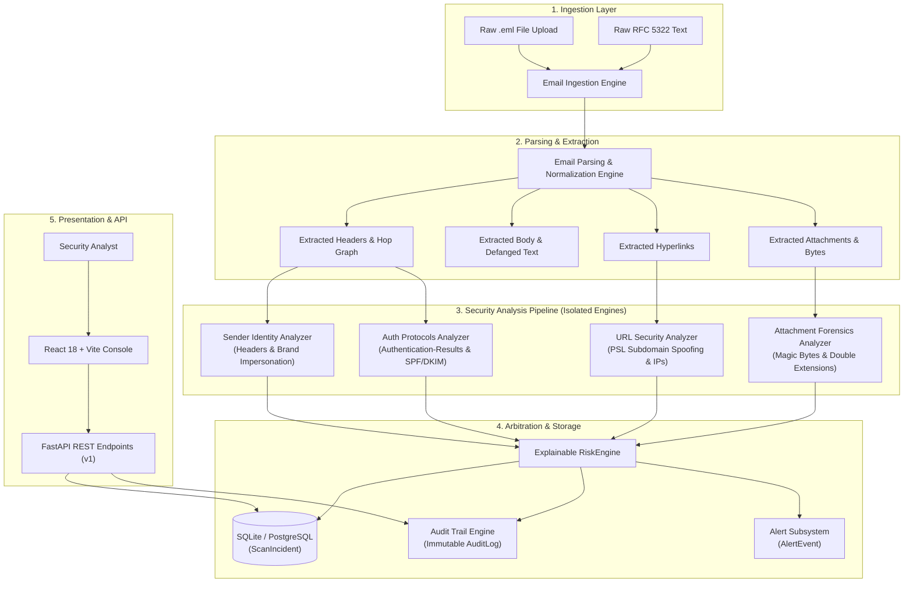

# MailSentra: Enterprise Email Security & Threat Detection Platform

[](#)
[](#)
[](#)
[](#)
[](#)
[](#)
[](#)
[](#)

MailSentra is a defense-in-depth email threat detection and digital forensics platform engineered to identify advanced phishing, executive and brand impersonation, structural RFC 5322 header anomalies, deceptive hyperlinks, and disguised binary attachments using deterministic, explainable risk scoring.

---

## Table of Contents

- [1. Overview and Problem Statement](#1-overview-and-problem-statement)
- [2. Key Capabilities](#2-key-capabilities)
- [3. System Architecture](#3-system-architecture)
- [4. Email-Processing and Detection Workflow](#4-email-processing-and-detection-workflow)
- [5. Technology Stack](#5-technology-stack)
- [6. Security Design and Defensive Controls](#6-security-design-and-defensive-controls)
- [7. Installation and Configuration](#7-installation-and-configuration)
- [8. Running the Backend and Frontend](#8-running-the-backend-and-frontend)
- [9. API Usage Examples](#9-api-usage-examples)
- [10. Testing and Verification](#10-testing-and-verification)
- [11. Controlled Detection Test Results](#11-controlled-detection-test-results)
- [12. Implemented vs. Planned Capabilities](#12-implemented-vs-planned-capabilities)
- [13. Known Limitations](#13-known-limitations)
- [14. Development Roadmap](#14-development-roadmap)
- [15. Repository Structure](#15-repository-structure)
- [16. Technical Documentation Index](#16-technical-documentation-index)
- [17. Responsible Use & Disclaimer](#17-responsible-use--disclaimer)

---

## 1. Overview and Problem Statement

Modern enterprise email environments face sophisticated threats that circumvent traditional security boundaries:
- **Display Name and Subdomain Brand Impersonation**: Adversaries register lookalike domains or embed legitimate brand trademarks in subdomains (e.g. `signin.paypal.com.attacker-domain.com`) to deceive human recipients while passing superficial checks.
- **Structural Header Tampering**: Attackers exploit subtle ambiguities in RFC 5322 parsing—such as mismatched `From:` and `Reply-To:` domains, multiple address headers, or invalid routing constructs—to redirect victim replies while evading basic filters.
- **Disguised Executable Attachments**: Malicious binaries are masked using double extensions (e.g. `Invoice.xlsx.exe`), manipulated MIME types, or compressed containers to trick operating system shell handlers.
- **Opaque Scoring Engines**: Black-box heuristic engines frequently fail in Security Operations Center (SOC) environments because they do not output transparent, audit-ready explanations for their verdicts.

**MailSentra** addresses these challenges by implementing an inspectable, high-cohesion modular architecture. Every message is parsed through isolated, deterministic detection engines that produce verifiable forensic signals, culminating in an explainable risk score and an immutable audit trail.

---

## 2. Key Capabilities

### RFC 5322 Ingestion and MIME Normalization
- Bounded stream ingestion with strict payload limits (10 MB default) to prevent memory exhaustion and Denial-of-Service (DoS).
- Deep traversal of nested multipart MIME trees (`multipart/mixed`, `multipart/alternative`, `multipart/related`).
- RFC 2047 multi-charset header decoding (UTF-8, ISO-8859-1, Windows-1252, GB2312).
- HTML entity stripping, unicode normalization, and link defanging for analyst safety.

### Sender Identity and Structural Header Integrity (Priority 1 & Priority 3)
- **Structural RFC 5322 Verification**: Actionable detection of `MALFORMED_SENDER_ADDRESS`, `DUPLICATE_FROM_HEADER`, `MISSING_FROM_HEADER`, `DUPLICATE_REPLY_TO_HEADER`, and `SENDER_FIELD_ANOMALIES`.
- **Envelope-Header Consistency**: Cross-checks `Return-Path` vs. `From:` vs. `Reply-To:` with safe, non-punitive handling for automated bounces (empty `Return-Path: <>`).
- **Display-Name Brand Impersonation**: Matches sender display names against a curated catalog of 17 enterprise brand profiles with explicit domain authorization lists. Implements homonym ambiguity filtering ("Apple", "Chase") and non-impersonation context exemptions (e.g. "Club", "Review").
- **Cousin-Domain & Homoglyph Detection**: Levenshtein distance calculations and Internationalized Domain Name (IDN) / Punycode decoding to identify character substitution attacks.

### Static Hyperlink Analysis (Priority 2)
- **Public Suffix List (PSL) Subdomain Brand Spoofing**: Deconstructs domains using `tldextract` to detect legitimate enterprise trademarks placed inside subdomains of unrelated registrable domains.
- **Obfuscation Detection**: Identifies IPv4/IPv6 literal hosts, hex/octal encoded IP strings, Punycode encoding, and excessive subdomain chaining.
- **High-Risk TLD Scoring**: Pattern heuristics for commonly abused top-level domains (`.xyz`, `.top`, `.tk`, `.zip`).

### In-Memory Attachment Forensics
- **True File Magic Byte Analysis**: Pure-Python binary header inspection (`b"MZ"` for DOS/PE Windows executables, `\x7fELF` for Linux binaries, `\xfe\xed\xfa` for Mach-O, `%PDF` for PDF documents).
- **Extension Spoofing Detection**: Flags dangerous executable extensions disguised behind double extensions (`.pdf.exe`, `.xlsx.exe`).
- **Cryptographic Hashing**: Computes SHA-256 and MD5 digests in memory without writing untrusted payloads to the host filesystem.
- **Office Document Macro Inspection**: Identifies legacy OLE and modern OpenXML macro indicators.

### Explainable Risk Engine
- Deterministic multi-factor scoring aggregating Identity, Authentication, URL, and Attachment signals into a calibrated score ($0.0 \dots 100.0$).
- Non-linear scoring saturation with cross-analyzer brand deduplication to prevent double-penalizing related signals.
- Transparent classification into three actionable tiers based on verified effective RiskEngine verdict boundaries:
  - **`CLEAN`** (Score: below $30.0$): Benign message; normal routing.
  - **`SUSPICIOUS`** (Score: $30.0 \dots 74.0$): Elevated threat indicators; quarantine or display banner recommended.
  - **`MALICIOUS`** (Score: $75.0 \dots 100.0$): High-confidence malicious artifact; automated blocking and SOC alert dispatch.

---

## 3. System Architecture

MailSentra is architected as a **High-Cohesion, Modular Monolith** in Python and TypeScript. All domain modules communicate through strongly-typed contracts defined in `app/modules/contracts.py`.



---

## 4. Email-Processing and Detection Workflow

1. **Ingestion & Buffer Bounding**: The file is streamed through `POST /api/v1/scans/upload`. If byte count exceeds `MAX_EMAIL_SIZE_BYTES` (10 MB), the connection terminates immediately with `413 Content Too Large`.
2. **Structural Decomposition**: `EmailParser` processes MIME boundaries, decodes header character sets, normalizes body content into defanged text, and isolates attachment byte buffers.
3. **Multi-Vector Analysis**:
   - `SenderIdentityAnalyzer` inspects address validity, From vs. Reply-To parity, and matches display names against the 17 protected brands.
   - `AuthProtocolsAnalyzer` parses `Authentication-Results` and `Received-SPF` headers. In direct file upload mode without live MTA relay telemetry, SPF evaluates as `NOT_EVALUATED` and DMARC operates in a fail-safe incomplete state.
   - `UrlAnalyzer` resolves domains against the Public Suffix List to identify brand hijacking in subdomains, evaluates IP hosts, and calculates TLD risk weights.
   - `AttachmentAnalyzer` evaluates file magic bytes, hashes payloads, and identifies executable signatures.
4. **Risk Synthesis**: `RiskEngine` consumes the analyzer results, applies non-linear saturation, calculates a score ($0.0 \dots 100.0$), and assigns the risk tier.
5. **Persistence & Auditing**:
   - The scan incident is committed to the relational database with full JSON telemetry.
   - An immutable, append-only audit log entry is recorded.
   - If the verdict is `MALICIOUS`, an alert record is created.
6. **Telemetry Delivery**: The parsed email structure and forensic observables are returned to the client and indexed for SOC review.

---

## 5. Technology Stack

| Layer | Component | Version / Specification | Architectural Rationale |
|---|---|---|---|
| **Backend Framework** | **FastAPI** | `^0.115.0` | Native ASGI async performance, automatic OpenAPI v3 documentation, Pydantic v2 data validation. |
| **Backend Runtime** | **Python** | `3.11+` (tested on 3.13) | Standard ecosystem for cybersecurity, forensics, and text normalization. |
| **Database** | **SQLite (Dev) / PostgreSQL (Prod)** | SQLite 3 / PG 16+ | Zero-configuration local development via WAL mode; robust relational transactions and `JSONB` telemetry storage in production. |
| **ORM & Database Driver** | **SQLAlchemy + aiosqlite / asyncpg** | `^2.0.32` | Fully asynchronous Object-Relational Mapping with strict schema models and connection pooling. |
| **Frontend Framework** | **React** | `18.3.1` | Component-based Single-Page Application (SPA) architecture separating presentation from security logic. |
| **Language (Frontend)** | **TypeScript** | `5.5.3` | End-to-end type safety aligning frontend models with backend Pydantic schemas. |
| **Build Tooling** | **Vite** | `5.4.2` | Lightning-fast development server with Hot Module Replacement and optimized production bundling. |
| **Styling & UI** | **Tailwind CSS + Lucide React** | `3.4.10` / `0.441.0` | Utility-first responsive CSS styling with dark-mode security console aesthetics and clean iconography. |
| **Testing Harness** | **Pytest + Pytest-Asyncio** | `8.3.2` / `0.24.0` | Comprehensive async unit, integration, and security regression testing suite. |

---

## 6. Security Design and Defensive Controls

MailSentra enforces defensive security practices across every operational tier:

- **BOLA / IDOR Protection**: Object-level access control (`authorize_scan_incident_access`) validates tenant and user boundaries on scan telemetry lookups. API keys are restricted to write-only ingestion and cannot read scan telemetry.
- **Defensive HTTP Headers**: Enforced via FastAPI middleware on all responses:
  ```http
  X-Content-Type-Options: nosniff
  X-Frame-Options: DENY
  X-XSS-Protection: 1; mode=block
  Referrer-Policy: strict-origin-when-cross-origin
  Permissions-Policy: geolocation=(), microphone=(), camera=()
  ```
- **Payload Bounding**: Explicit chunked-stream limits prevent unauthenticated uploaders from exhausting system memory.
- **In-Memory Attachment Handling**: Untrusted attachment bytes are processed strictly in memory for magic-byte and hash calculation. No files are executed, extracted to disk, or launched in the host OS.
- **Credential Storage**: Cryptographic password hashing utilizing Passlib with memory-hard Argon2id and Bcrypt algorithms.
- **Application-Level Append-Only Audit Logging**: Security-relevant actions generate append-only audit records stored in the `audit_records` table with actor identification and IP tracking. No modification (`PUT`/`PATCH`/`DELETE`) endpoints exist for audit records.

---

## 7. Installation and Configuration

### Prerequisites
- **Python**: Version 3.11, 3.12, or 3.13
- **Node.js**: Version 18.x, 20.x, or 22.x (with npm)
- **Git**

### 1. Clone the Repository
```bash
git clone https://github.com/vatsalgupta799-pixel/MailSentra.git
cd MailSentra
```

### 2. Backend Environment Setup
```powershell
# Navigate to backend directory
cd backend

# Create Python virtual environment
python -m venv .venv

# Activate virtual environment
# On Windows PowerShell:
.\.venv\Scripts\Activate.ps1
# On Linux/macOS:
# source .venv/bin/activate

# Install dependencies
pip install -r requirements.txt
```

### 3. Backend Configuration
Copy the sample environment file:
```powershell
# On Windows PowerShell:
Copy-Item .env.example .env
# On Linux/macOS:
# cp .env.example .env
```

Key environment variables in `backend/.env`:
```ini
ENVIRONMENT=development
PROJECT_NAME="MailSentra"
SECRET_KEY="dev_secret_key_change_in_production_mailsentra_secops_platform"
DATABASE_URL="sqlite+aiosqlite:///./mailsentra.db"
MAX_EMAIL_SIZE_BYTES=10485760
ENFORCE_INGESTION_AUTH=false
```

### 4. Frontend Setup
```powershell
# Navigate to frontend directory
cd ../frontend

# Install Node dependencies
npm install
```

---

## 8. Running the Backend and Frontend

### Start the Backend Server
```powershell
cd backend
# Ensure virtual environment is active
python main.py
```
- **API Server**: `http://127.0.0.1:8000`
- **Interactive Swagger Documentation**: `http://127.0.0.1:8000/docs`
- **Redoc Documentation**: `http://127.0.0.1:8000/redoc`
- **Health Endpoint**: `http://127.0.0.1:8000/api/v1/health`

### Start the Frontend Console
In a separate terminal:
```powershell
cd frontend
npm run dev
```
- **Threat Defense Console**: `http://localhost:5173`

The frontend Vite server automatically proxies `/api` calls to the FastAPI backend running on port 8000.

---

## 9. API Usage Examples

### 1. Health and Readiness Check
```bash
curl -X GET http://127.0.0.1:8000/api/v1/health
```
**Response (`200 OK`):**
```json
{
  "status": "healthy",
  "project_name": "MailSentra",
  "environment": "development"
}
```

### 2. Upload and Ingest an EML File
```bash
curl -X POST http://127.0.0.1:8000/api/v1/scans/upload \
  -F "file=@backend/tests/fixtures/real_world_emails/suspicious/05_mismatched_from_replyto.eml"
```
**Response (`201 Created`):**
```json
{
  "scan_id": 11,
  "scan_uuid": "b93737e0-69f4-41a1-a294-7f1b9a44466c",
  "status": "COMPLETED",
  "parsed_email": {
    "message_id": "<20261128131700.chase.tickets@secure-resolve-tickets.net>",
    "subject": "Urgent: Account Verification Required",
    "from_sender": {
      "raw": "\"JPMorgan Chase Support\" <no-reply@chase.com>",
      "display_name": "JPMorgan Chase Support",
      "address": "no-reply@chase.com",
      "domain": "chase.com"
    },
    "reply_to": {
      "raw": "<chase-fraud-prevention@secure-resolve-tickets.net>",
      "display_name": null,
      "address": "chase-fraud-prevention@secure-resolve-tickets.net",
      "domain": "secure-resolve-tickets.net"
    },
    "return_path": "bounce-handler@secure-resolve-tickets.net",
    "to_recipients": [
      {
        "raw": "customer@example.com",
        "display_name": null,
        "address": "customer@example.com",
        "domain": "example.com"
      }
    ],
    "urls": [
      {
        "original_url": "https://secure-resolve-tickets.net/chase/login",
        "normalized_url": "https://secure-resolve-tickets.net/chase/login",
        "defanged_url": "hxxps[://]secure-resolve-tickets[.]net/chase/login",
        "visible_text": "Verify Your Account Now",
        "source_location": "html_href"
      }
    ],
    "attachments": []
  },
  "created_at": "2026-11-28T13:17:01.000000"
}
```

### 3. Retrieve Comprehensive Scan Telemetry and Verdict
```bash
curl -X GET http://127.0.0.1:8000/api/v1/scans/11
```
**Response (`200 OK`):**
```json
{
  "id": 11,
  "scan_uuid": "b93737e0-69f4-41a1-a294-7f1b9a44466c",
  "filename": "05_mismatched_from_replyto.eml",
  "status": "COMPLETED",
  "risk_score": 59.0,
  "risk_tier": "SUSPICIOUS",
  "verdict_summary": "SUSPICIOUS (Score: 59.0) - Structural header anomalies and domain mismatch detected.",
  "telemetry": {
    "identity": {
      "envelope_header_match": false,
      "from_replyto_match": false,
      "brand_impersonation_detected": true
    },
    "risk_signals": [
      "FROM_REPLYTO_DOMAIN_MISMATCH",
      "DISPLAY_NAME_BRAND_IMPERSONATION"
    ]
  },
  "created_at": "2026-11-28T13:17:01.000000"
}
```

---

## 10. Testing and Verification

MailSentra maintains a comprehensive automated testing suite. All tests execute deterministically offline without external network dependencies.

### Run Backend Unit & Integration Tests
```powershell
# Run full suite
$env:PYTHONPATH=".;backend"; & backend\.venv\Scripts\pytest.exe backend/tests/ -q
```
**Expected Outcome:**
- **`904 passed, 18 warnings in ~12s`** across the complete test suite (covering core detection engines, Phase 5.1 benchmark metric integrity, educational link consequence guidance, and operational SOC dashboard/alerts endpoints).

### Run Live API End-to-End Verification
```powershell
# Executes 5 live HTTP checks against the running backend server
$env:PYTHONPATH=".;backend"; & backend\.venv\Scripts\python.exe backend/tests/verify_live_api.py
```
**Checks Executed:**
1. Health check & security headers (`nosniff`, `X-Frame-Options: DENY`)
2. File upload & parsing workflow (`201 Created`)
3. Scan record retrieval & telemetry validation (`200 OK`)
4. Input validation (rejection of non-EML executable uploads with `422`)
5. Boundary validation (rejection of excessive pagination queries with `422`)

### Build Frontend Application
```powershell
cd frontend
npm run build
```
**Expected Outcome:** TypeScript type-check and Vite production build pass cleanly with 0 errors.

---

## 11. Controlled Detection Test Results

Five controlled detection fixture tests were executed through the running application to verify deterministic scoring across foundational threat archetypes:

| Test | Fixture Filename | Scan ID | Verdict | Risk Score | Key Forensic Finding |
|---|---|---|---|---|---|
| **1** | `normal/01_university_announcement.eml` | `#9` | `CLEAN` | `0.0` | Normal announcement; clean headers; 0 threat signals. |
| **2** | `suspicious/03_fake_admin.eml` | `#10` | `SUSPICIOUS` | `47.0` | Phishing lure; suspicious IP/subdomain destination. |
| **3** | `suspicious/05_mismatched_from_replyto.eml` | `#11` | `SUSPICIOUS` | `59.0` | Visible `From: chase.com` vs. `Reply-To: secure-resolve-tickets.net`. |
| **4** | `edge_cases/09_invalid_sender_address.eml` | `#12` | `SUSPICIOUS` | `57.0` | Malformed address tokens; structural RFC 5322 header anomaly. |
| **5** | `suspicious/16_suspicious_attachment_filename.eml` | `#13` | `MALICIOUS` | `87.0` | Disguised executable (`.xlsx.exe`) with `b"MZ"` PE magic bytes. |

*For complete forensic details and telemetry dumps, see [CONTROLLED_DETECTION_TESTS.md](CONTROLLED_DETECTION_TESTS.md).*

---

## 12. Implemented vs. Planned Capabilities

| Capability Category | Feature | Status | Notes |
|---|---|---|---|
| **Ingestion** | RFC 5322 EML File Upload | **Implemented** | Stream-bounded upload via REST API. |
| **Ingestion** | Raw Text Ingestion | **Implemented** | JSON endpoint for raw RFC 5322 payloads. |
| **Ingestion** | Live SMTP Milter / Relay Listener | *Planned* | Post-Phase 4 enterprise roadmap item. |
| **Ingestion** | M365 / Google Workspace API Sync | *Planned* | Post-Phase 4 enterprise roadmap item. |
| **Identity** | Structural Header Anomaly Detection | **Implemented** | RFC 5322 violation detection (Priority 1). |
| **Identity** | Display-Name Brand Impersonation | **Implemented** | 17 protected brands with PSL domain verification (Priority 3). |
| **Identity** | Homoglyph & Typosquatting Analysis | **Implemented** | Punycode decoding and Levenshtein distance scans. |
| **Auth Protocols** | `Authentication-Results` Header Parsing | **Implemented** | Local parsing of SPF, DKIM, and DMARC result tokens. |
| **Auth Protocols** | Live MTA DNS Cryptographic Verification | *Partially Implemented* | Local parser operational; live DNS disabled in offline upload mode. |
| **URL Security** | PSL Subdomain Brand Impersonation | **Implemented** | Offline Public Suffix List brand hijacking detection (Priority 2). |
| **URL Security** | IP Hosts & Suspicious TLD Scoring | **Implemented** | Deterministic pattern matching. |
| **URL Security** | Live Threat Intel Connectors (VirusTotal) | *Planned* | Requires external cloud API keys. |
| **Attachment** | True Magic Byte File Identification | **Implemented** | In-memory header signatures (DOS/MZ, PE, ELF, Mach-O). |
| **Attachment** | Double-Extension Spoofing Detection | **Implemented** | Identifies deceptive executable extension chains. |
| **Attachment** | Dynamic Sandbox Detonation | *Planned* | Requires dedicated virtualized execution guest. |
| **Risk Engine** | Multi-Vector Risk Scoring & Saturation | **Implemented** | Calibrated $0 \dots 100$ scoring with explainable signals. |
| **SOC Console** | Incident Inspection & Telemetry Views | **Implemented** | React 18 + Vite dashboard (`http://localhost:5173`). |
| **SOC Console** | Live Alert Webhooks / Syslog Dispatch | *Planned* | Internal database alert model implemented; live dispatchers planned. |

---

## 13. Known Limitations

- **Offline Operating Assumption**: To enable zero-configuration, air-gapped development, the core detection pipeline does not contact external cloud reputation feeds. Detection relies entirely on structural, pattern-based, and cryptographic header forensics.
- **Authentication Semantics in EML Uploads**: In direct `.eml` file upload mode, live network metadata (connecting MTA IP address, active TCP socket) is unavailable. Consequently, SPF evaluates as `NOT_EVALUATED` and DMARC operates in an incomplete state rather than speculating.
- **Attachment Static Analysis**: Attachment inspection is strictly static and signature-based (magic bytes, headers, hashes). It does not execute payloads in a sandbox or observe runtime behavioral artifacts.
- **Frontend Upload Telemetry Display**: The frontend upload response card currently displays extracted MIME observables (hops, links, attachment forensics). To view the complete numerical risk score badge and verdict tier, analysts can inspect the record via `GET /api/v1/scans/{id}` or the Swagger API console.

---

## 14. Development Roadmap

- **Phase 1: Foundation and Ingestion Architecture** *(Completed)*
  - RFC 5322 MIME normalization, Pydantic v2 data contracts, and FastAPI async foundations.
- **Phase 2: Core Detection Pipeline** *(Completed)*
  - Priority 1: Structural header verification (`MALFORMED_SENDER_ADDRESS`, envelope checks).
  - Priority 2: Public Suffix List (PSL) subdomain brand impersonation.
  - Priority 3: Display-name brand impersonation across 17 enterprise profiles.
  - Attachment magic-byte forensics and double extension detection.
- **Phase 3: RiskEngine & SOC Presentation** *(Completed)*
  - Non-linear scoring saturation, cross-analyzer deduplication, and React 18 dashboard.
- **Phase 4: Dataset Benchmarking & Rigor** *(In Progress)*
  - Evaluation against external corpora (SpamAssassin, Nazario, EPVME).
  - Mathematical division-by-zero metric integrity remediation.
- **Phase 5: Enterprise Connectors & Live Feeds** *(Future)*
  - Live SMTP proxy/milter daemon.
  - VirusTotal / AbuseIPDB reputation connectors.
  - Syslog (RFC 5424) and Webhook alert streaming.

*For detailed task breakdowns, see [DEVELOPMENT_ROADMAP.md](DEVELOPMENT_ROADMAP.md).*

---

## 15. Repository Structure

```
MailSentra/
├── backend/                       # Core FastAPI Backend & Security Subsystems
│   ├── app/
│   │   ├── api/                   # REST API Versioning & Endpoints (v1)
│   │   │   ├── deps.py            # Authentication & Database Dependency Injection
│   │   │   └── v1/
│   │   │       ├── router.py      # Master v1 API Router
│   │   │       └── endpoints/     # Domain Endpoints (scans, auth, alerts, audit, health)
│   │   ├── core/                  # Security, Configuration, JWT, and Logging
│   │   ├── db/                    # SQLAlchemy Async Engine, Sessions, and Base Models
│   │   ├── models/                # Relational Models (ScanIncident, User, Alert, AuditLog)
│   │   ├── schemas/               # Pydantic v2 Request/Response Data Contracts
│   │   ├── modules/               # Security Analysis Domain Modules
│   │   │   ├── contracts.py       # Strongly-Typed Cross-Module Interfaces
│   │   │   ├── ingestion/         # EML Stream & Payload Bounding Subsystem
│   │   │   ├── parser/            # RFC 5322 MIME Normalization Engine
│   │   │   ├── identity/          # Header Anomaly & Brand Impersonation Engine
│   │   │   ├── auth_protocols/    # SPF, DKIM, and DMARC Evaluation Subsystem
│   │   │   ├── url_analysis/      # URL Canonicalization & PSL Subdomain Analyzer
│   │   │   ├── attachment_analysis/ # In-Memory Magic Byte & Binary Forensics Engine
│   │   │   ├── risk_engine/       # Deterministic Multi-Vector Risk Engine
│   │   │   └── audit/             # Append-Only Security Audit Logging
│   │   └── services/              # Orchestration Services (ScanService)
│   ├── tests/                     # 904-Test Pytest Suite (Unit, Integration, Regression)
│   │   ├── fixtures/              # Curated Synthetic & Real-World Test Fixtures
│   │   └── verify_live_api.py     # End-to-End Live HTTP Integration Test Script
│   ├── .env.example               # Sanitized Backend Environment Configuration Template
│   ├── requirements.txt           # Python Production & Test Dependencies
│   └── main.py                    # ASGI Application Server Entrypoint
├── frontend/                      # React 18 + TypeScript + Vite SOC Console
│   ├── src/
│   │   ├── components/            # Reusable UI Layout Components (Header, Sidebar)
│   │   ├── pages/                 # Console Pages (Dashboard, Scans, Alerts, Audit)
│   │   ├── services/              # Axios API Client with Auto-Interceptors
│   │   ├── types/                 # TypeScript Contract Definitions
│   │   ├── App.tsx                # Client Routing & Shell Layout
│   │   └── main.tsx               # Frontend Bootstrap Entrypoint
│   ├── package.json               # Node Dependencies and Scripts
│   ├── vite.config.ts             # Vite Configuration & Backend Proxy Rules
│   └── tailwind.config.js         # Tailwind CSS Utility Styling Configuration
├── ARCHITECTURE.md                # System Architecture & Component Design Specification
├── TECH_STACK.md                  # Comprehensive Technology Evaluation Matrix
├── SECURITY_DESIGN.md             # Threat Modeling (STRIDE) & Defensive Security Controls
├── DEVELOPMENT_ROADMAP.md         # Multi-Phase Engineering Timeline & Verified Statuses
├── CONTROLLED_DETECTION_TESTS.md  # Detailed Execution Reports for 5 Controlled Test Fixtures
└── README.md                      # Primary Project Documentation
```

---

## 16. Technical Documentation Index

For in-depth technical analysis and implementation reports:

- [ARCHITECTURE.md](ARCHITECTURE.md): Component interactions, data contracts, and subsystem specifications.
- [TECH_STACK.md](TECH_STACK.md): Detailed architectural justifications for framework, database, and library selections.
- [SECURITY_DESIGN.md](SECURITY_DESIGN.md): Comprehensive STRIDE threat model, defensive controls, and RBAC matrix.
- [DEVELOPMENT_ROADMAP.md](DEVELOPMENT_ROADMAP.md): Detailed engineering roadmap tracking completed milestones and future phases.
- [CONTROLLED_DETECTION_TESTS.md](CONTROLLED_DETECTION_TESTS.md): Full forensic execution logs and telemetry for the five controlled detection tests.

---

## 17. Responsible Use & Disclaimer

MailSentra is developed for defensive cybersecurity engineering, digital forensics research, and educational demonstration. 

- **Intended Use**: This software is designed to assist organizations and security analysts in identifying and mitigating inbound email security threats.
- **Safe Payload Handling**: Test fixtures included in `backend/tests/fixtures/` contain truncated, non-weaponized file signatures (such as PE DOS stubs) strictly for static parser validation. Do not deploy or execute untested binaries in untrusted environments.
- **Accuracy Notice**: While MailSentra achieves high fidelity on structural header anomalies and brand impersonation attacks, no automated detection system provides 100% detection against all evasion techniques. Organizations should maintain defense-in-depth security architectures.
