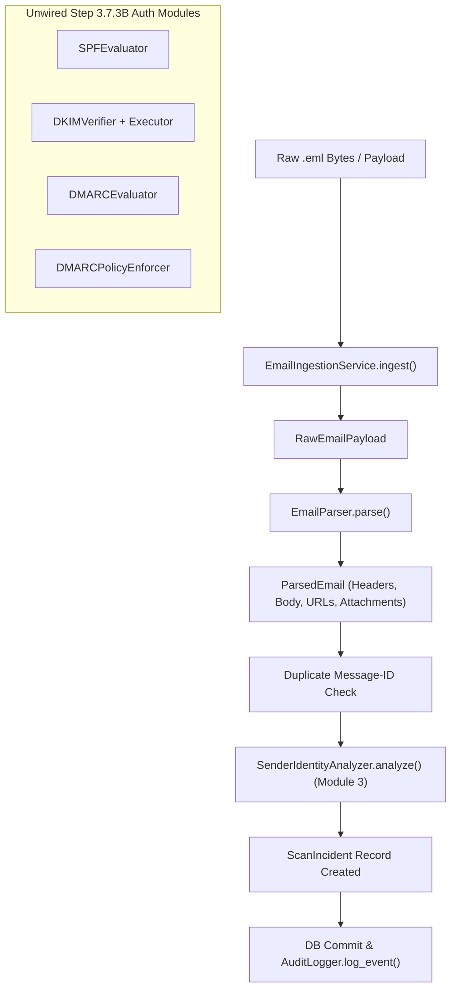
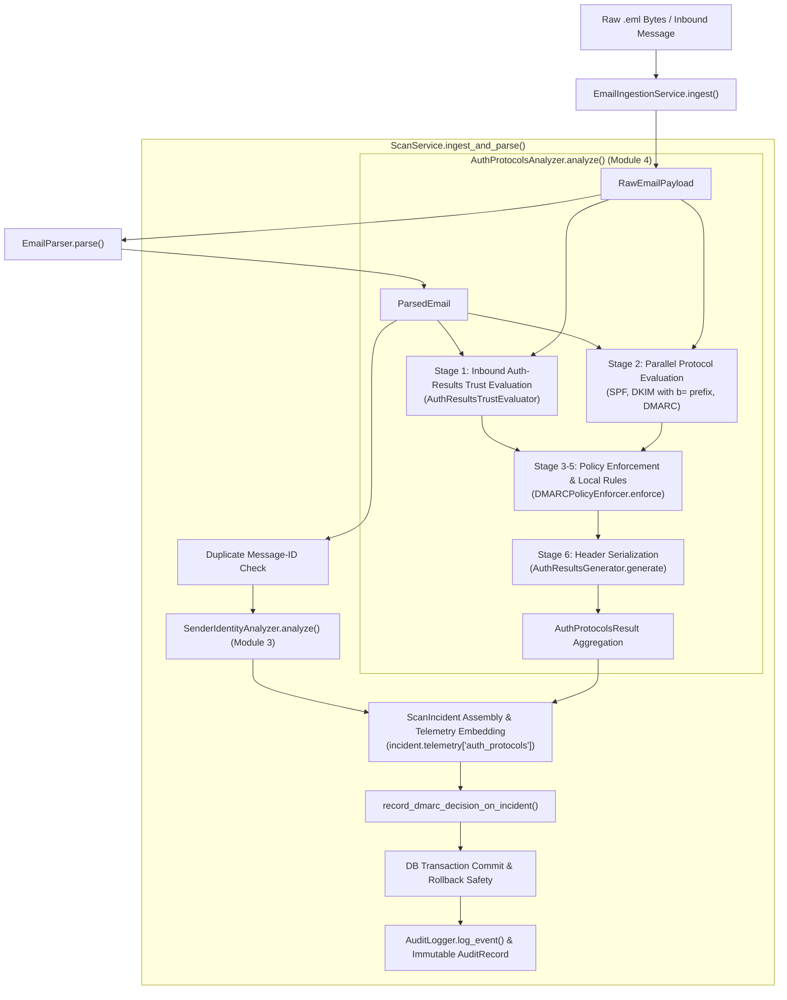
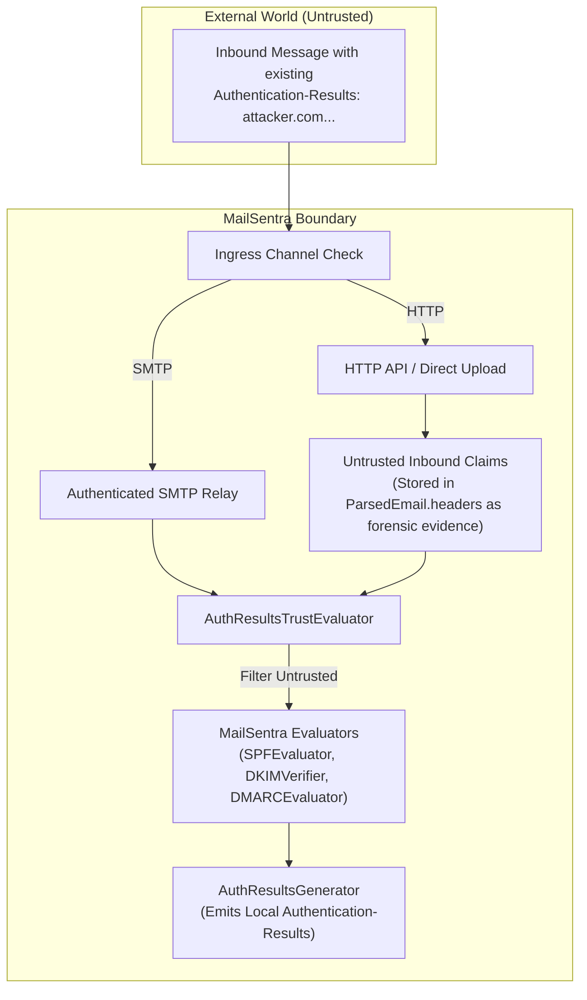

# MailSentra — Step 3.7.3C: Pre-Implementation Architecture & Security Assessment

**Document ID:** `MS-ARCH-SEC-2026-STEP-3-7-3C-PLAN`  
**Repository:** `C:\Users\vatsa\OneDrive\Desktop\MailSantra`  
**Branch:** `main`  
**Verified Baseline HEAD Commit:** `113132f66b37dc71cf681e15db1925d6b9f68069`  
**Mode:** READ-ONLY ARCHITECTURAL DESIGN & SECURITY ASSESSMENT (NO PRODUCTION CODE MUTATIONS)  
**Target Milestone:** **Step 3.7.3C — Authentication-Results Header Generation, local_authserv_id Formatting, and Scan Pipeline Delivery Integration**

---

## 1. Executive Summary

This document establishes the authoritative pre-implementation architecture, security model, and execution roadmap for **Step 3.7.3C**. Following the successful completion and independent verification of Step 3.7.3B Final Hardening (where all six findings `L3`, `H2`, `H3`, `M1`, `L1`, `L2` were closed and verified with 409 passing tests), MailSentra is prepared to integrate email authentication outcomes into its delivery and telemetry pipelines.

Step 3.7.3C bridges the gap between raw analytical protocol evaluators (`SPFEvaluator`, `DKIMVerifier`, `DMARCEvaluator`, `DMARCPolicyEnforcer`) and actionable email delivery artifacts. It defines how MailSentra generates standards-compliant `Authentication-Results` headers (RFC 8601, RFC 7601, RFC 6008), validates the local administrative domain identity (`local_authserv_id`), enforces strict trust boundaries against incoming spoofed headers, and orchestrates pipeline execution within `ScanService` without compromising existing cryptographic, policy, or tenant protections.

### Core Architecture Highlights
1. **Dedicated Generation Engine (`AuthResultsGenerator`):** A pure, deterministic serialization component implementing RFC 8601 / RFC 7601 / RFC 6008 ABNF grammar, strict line folding (`<= 78` chars per RFC 5322 §2.1.1), zero CRLF injection tolerance, and explicit omission of unverified or indeterminate internal results.
2. **Cryptographic Signature Disambiguation (RFC 6008 `header.b`):** Integration of the `header.b` signature prefix tag into `DKIMSignatureResult` and header generation to uniquely bind each DKIM result clause to its originating signature.
3. **Dedicated Administrative Identity (`local_authserv_id`):** Strict FQDN/atom token syntax validation, startup fail-fast validation in `AuthProtocolsConfig` and `Settings`, and absolute isolation from untrusted message headers or user inputs.
4. **Three-Tier Trust Boundary:** Unambiguous distinction between untrusted inbound authentication claims, trusted upstream MTA claims (RFC 8601 §5), and MailSentra locally generated results.
5. **Non-Mutating Channel Semantics:** On HTTP uploads (`DIRECT_UPLOAD`, `RAW_PAYLOAD`), raw message bytes are never altered or prepended; the generated header is stored solely as structured telemetry (`ScanIncident.telemetry["auth_protocols"]`). On future SMTP relay, headers are prepended cleanly above existing trace headers without modifying existing upstream fields.
6. **Pipeline Orchestrator (`AuthProtocolsAnalyzer`):** A unified `BaseDetectionModule` coordinating DNS resolution budgets, async SPF/DKIM/DMARC execution, policy enforcement, and audit persistence.

---

## 2. Existing Architecture Assessment

An exhaustive inspection of the existing codebase was conducted across `backend/app/`, modules, evaluators, contracts, and services.

### 2.1 Component State & Boundaries

| Component | File Path | Current Status & Capabilities | Step 3.7.3C Role |
| :--- | :--- | :--- | :--- |
| **Contracts** | [contracts.py](file:///c:/Users/vatsa/OneDrive/Desktop/MailSantra/backend/app/modules/contracts.py) | Defines `AuthProtocolsResult`, `ParsedAuthResultsHeader`, `DKIMEvaluationState`, `DMARCEnforcementDecision`. | Add `signature_b_prefix` to `DKIMSignatureResult`; add `generated_auth_results_header` to `AuthProtocolsResult`. |
| **Config** | [config.py](file:///c:/Users/vatsa/OneDrive/Desktop/MailSantra/backend/app/modules/auth_protocols/config.py) | Holds DNS budgets, forwarder lists, override rules; lacks `local_authserv_id`. | Add `local_authserv_id` with strict regex validation and startup checks. |
| **DNS Resolver** | [dns_resolver.py](file:///c:/Users/vatsa/OneDrive/Desktop/MailSantra/backend/app/modules/auth_protocols/dns_resolver.py) | Async resolver with strict MRO exception handling, negative caching, and 15-query product budget. | Used unchanged by SPF, DKIM, and DMARC evaluators. |
| **SPF Evaluator** | [spf.py](file:///c:/Users/vatsa/OneDrive/Desktop/MailSantra/backend/app/modules/auth_protocols/evaluators/spf.py) | Full RFC 7208 evaluation, macro expansion, void lookup limits, synthesized MAIL FROM handling. | Provides `SPFResult` to generator and analyzer. |
| **DKIM Verifier** | [dkim.py](file:///c:/Users/vatsa/OneDrive/Desktop/MailSantra/backend/app/modules/auth_protocols/evaluators/dkim.py) | Verifies multiple signatures via `DKIMExecutor`; extracts `d=`, `s=`, `i=`, `a=`, `c=`. | Extract `b=` prefix (`signature_b_prefix`) for RFC 6008 `header.b`. |
| **DMARC Evaluator** | [dmarc.py](file:///c:/Users/vatsa/OneDrive/Desktop/MailSantra/backend/app/modules/auth_protocols/evaluators/dmarc.py) | RFC 9989 discovery, tree walk, PSD fallback, authoritative alignment check, `t=y` test mode tracking. | Provides `DMARCResult` to generator and enforcer. |
| **Policy Enforcer** | [policy_enforcer.py](file:///c:/Users/vatsa/OneDrive/Desktop/MailSantra/backend/app/modules/auth_protocols/policy_enforcer.py) | Tier 3 local policy engine (Stages 3–5), HMAC rule attestation, forwarder trust boundary, atomic audit persistence. | Provides `DMARCEnforcementDecision` to generator. |
| **Scan Service** | [scan_service.py](file:///c:/Users/vatsa/OneDrive/Desktop/MailSantra/backend/app/services/scan_service.py) | Coordinates ingestion, parsing, duplicate detection, identity analysis (Module 3). | Wire `AuthProtocolsAnalyzer` (Module 4) into `ingest_and_parse()`. |
| **Email Parser** | [parser.py](file:///c:/Users/vatsa/OneDrive/Desktop/MailSantra/backend/app/modules/parser/parser.py) | Extracts RFC 5322 headers into `headers_list` and `headers_map`. | Supplies raw inbound `Authentication-Results` headers to trust evaluator. |

### 2.2 Existing Gaps to Close in Step 3.7.3C
1. **Absence of Dedicated Header Generator:** No component exists to serialize `SPFResult`, `DKIMSignatureResult`, `DMARCResult`, and `DMARCEnforcementDecision` into an RFC 8601 header string.
2. **Missing `local_authserv_id` Configuration:** `AuthProtocolsConfig` and `core/config.py` contain `trusted_authserv_ids` but lack the primary local identifier `local_authserv_id`.
3. **Missing RFC 6008 `header.b` in DKIM Output:** `DKIMSignatureResult` does not capture the signature `b=` prefix, preventing downstream verifiers from distinguishing multiple signatures from the same domain.
4. **Pipeline Disconnection:** `ScanService` executes Module 1 (Ingestion), Module 2 (Parsing), and Module 3 (Identity Analysis), but does not invoke Module 4 (Authentication Protocols).
5. **Inbound Header Trust Evaluation:** Inbound `Authentication-Results` headers present in `ParsedEmail.headers` are parsed as generic strings but are not yet evaluated through `AuthResultsTrustEvaluator`.

---

## 3. Scan Pipeline and Data-Flow Architecture

### 3.1 Current Pipeline State (Step 3.7.3B)


### 3.2 Target Step 3.7.3C Integrated Pipeline


---

## 4. Proposed Authentication-Results Architecture

### 4.1 Standards Grammar & Syntax (RFC 8601 §2.2, RFC 7601, RFC 6008)
The header format adheres strictly to the RFC 8601 ABNF specification:
```text
Authentication-Results: <authserv-id> [version] ; <resinfo> *(; <resinfo>)
```
Where each `<resinfo>` clause represents an evaluated authentication method:
```text
; <method>=<result> [reason="<comment>"] [<proptype>.<property>=<value> ...]
```

### 4.2 Handling "No Results" (RFC 8601 §2.2)
If all authentication methods produced no reportable result (e.g. SPF is `NOT_EVALUATED`, DKIM is unrun, and DMARC is `NOT_EVALUATED` or `INDETERMINATE`), the generator serializes the standard RFC 8601 §2.2 `none` keyword:
```text
Authentication-Results: mailsentra.local; none
```
Under no circumstances will the generator falsify protocol outcomes or emit `dmarc=fail` / `dmarc=none` when checks were not performed.

### 4.3 Protocol Result Mapping Matrix

| Evaluated Status (`ProtocolStatus`) | SPF Method (`spf=`) | DKIM Method (`dkim=`) | DMARC Method (`dmarc=`) |
| :--- | :--- | :--- | :--- |
| **`PASS`** | `spf=pass` | `dkim=pass` | `dmarc=pass` |
| **`FAIL`** | `spf=fail` | `dkim=fail` | `dmarc=fail` |
| **`SOFTFAIL`** | `spf=softfail` | *(Invalid for DKIM)* | *(Invalid for DMARC)* |
| **`NEUTRAL`** | `spf=neutral` | `dkim=neutral` | *(Invalid for DMARC)* |
| **`NONE`** | `spf=none` | `dkim=none` (if 0 sigs verified) | `dmarc=none` (if no record found) |
| **`TEMPERROR`** | `spf=temperror` | `dkim=temperror` | `dmarc=temperror` |
| **`PERMERROR`** | `spf=permerror` | `dkim=permerror` | `dmarc=permerror` |
| **`POLICY`** | *(Invalid for SPF)* | `dkim=policy` | *(Invalid for DMARC)* |
| **`INDETERMINATE`** | **OMITTED** | **OMITTED** | **OMITTED** |
| **`NOT_EVALUATED`** | **OMITTED** | **OMITTED** | **OMITTED** |

### 4.4 Method-Specific Property Specifications

#### 1. SPF Clause (`spf`)
- Standard MailFrom scope:
  ```text
  spf=pass (mailsentra: SPF record matches) smtp.mailfrom=example.com
  ```
- Null Reverse-Path / Synthesized HELO scope:
  ```text
  spf=pass (mailsentra: HELO identity matches) smtp.helo=outbound.mailrelay.com
  ```
- Identity Privacy: In accordance with RFC 8601 §2.7.2, local-parts of email addresses are omitted (`smtp.mailfrom=<domain>`) because SPF authenticates the domain, not the specific mailbox, preserving PII privacy.

#### 2. DKIM Clause (`dkim` & RFC 6008 `header.b`)
- If zero signatures were found in message and verifier ran:
  ```text
  dkim=none (no signatures found)
  ```
- For each verified signature (up to defensive cap of 10 signatures):
  ```text
  dkim=pass (2048-bit RSA valid) header.d=example.com header.s=s202401 header.b=a1b2c3d4 header.a=rsa-sha256
  ```
- Disambiguation via `header.b`: RFC 6008 §4 requires emitting at least the first 8 characters of the base64 signature (`b=`). If multiple signatures share identical prefixes, the prefix is dynamically extended to guarantee uniqueness.

#### 3. DMARC Clause (`dmarc`)
- Standard passing evaluation:
  ```text
  dmarc=pass (p=reject) header.from=example.com policy.dmarc=reject
  ```
- Evaluation with local administrative override (e.g. verified forwarder):
  ```text
  dmarc=fail (p=reject; local policy override: trusted forwarder) header.from=example.com policy.dmarc=reject policy.override=trusted_forwarder
  ```
- RFC 9989 §9.1 Table 3 compliance: `header.from=<normalized_from_domain>` is always emitted; `policy.dmarc=<effective_policy>` reflects the evaluated policy after `sp`/`np`/`t=y` processing.

### 4.5 CRLF Injection Defense & RFC 5322 Folding
1. **Character Sanitization:** All dynamic parameter values (domains, selectors, reasons, identities) are inspected for `\r`, `\n`, `\0`, and ASCII control characters (`< 0x20`). Any detected control character triggers immediate sanitization or rejection via `ValueError`.
2. **Safe Quoting:** Reasons and comments containing special characters (spaces, semicolons, parentheses) are wrapped in RFC 8601 `quoted-string` formatting with escaped internal quotes (`\"`) and backslashes (`\\`).
3. **Line Length & Folding:**
   - RFC 5322 §2.1.1 mandates that line lengths MUST NOT exceed 998 characters and SHOULD NOT exceed 78 characters.
   - The generator applies algorithmic folding at semicolon boundaries using RFC 5322 Folding White Space (`\r\n `):
     ```text
     Authentication-Results: mailsentra.local;
       spf=pass (mailsentra: SPF record matches) smtp.mailfrom=example.com;
       dkim=pass (2048-bit RSA valid) header.d=example.com header.s=s1 header.b=a1b2c3d4;
       dmarc=pass (p=reject) header.from=example.com policy.dmarc=reject
     ```
   - Every physical line is clamped to `<= 78` characters wherever syntactically permissible.

---

## 5. `local_authserv_id` Configuration & Validation Design

### 5.1 Configuration Parameter Integration
`local_authserv_id` is defined as a first-class configuration attribute in two locations:
1. `backend/app/modules/auth_protocols/config.py` in `AuthProtocolsConfig`:
   ```python
   local_authserv_id: Optional[str] = Field(
       default=None,
       description="RFC 8601 administrative domain identifier for local Authentication-Results generation."
   )
   ```
2. `backend/app/core/config.py` in `Settings`:
   ```python
   LOCAL_AUTHSERV_ID: Optional[str] = Field(
       default=None,
       description="System-wide authserv-id for Authentication-Results header generation."
   )
   ```

### 5.2 Syntax & Formatting Validation Rules
The identity must conform strictly to RFC 8601 §2.5:
- **Format:** Valid DNS Fully Qualified Domain Name (FQDN) or RFC 5322 atom token.
- **Regex Validation:**
  ```regex
  ^(?=.{1,255}$)[a-zA-Z0-9](?:[a-zA-Z0-9-]{0,61}[a-zA-Z0-9])?(?:\.[a-zA-Z0-9](?:[a-zA-Z0-9-]{0,61}[a-zA-Z0-9])?)*$
  ```
- **Disallowed Elements:** Whitespace, semicolons, colons, quotes, slashes, backslashes, non-ASCII characters, and control characters.
- **Maximum Length:** 255 characters.

### 5.3 Startup & Runtime Failure Behavior
- **Invalid Syntax:** If a non-empty string is provided that fails the syntax check, application startup halts immediately with a fatal `ValidationError` / `RuntimeError`.
- **Unconfigured (`None` / Empty):** If `local_authserv_id` is unset in configuration:
  - Header generation is safely skipped.
  - No `Authentication-Results` header is produced.
  - Telemetry logs `generated_auth_results_header: None` and `authserv_id_status: "UNCONFIGURED"`.
  - Development environments may provide a default (`mailsentra.local`), but production requires explicit configuration.
- **Untrusted Override Immunity:** Inbound email headers, SMTP envelope commands, or client HTTP headers CANNOT override the server-configured `local_authserv_id`.

---

## 6. Trust Boundary and Header Security Analysis

### 6.1 Distinction Between Inbound and Local Authentication Claims
Email messages received over the network frequently arrive with existing `Authentication-Results` headers injected by upstream MTAs, relays, or malicious senders.



### 6.2 Protections Against Header Forgery & Confusion
1. **Inbound Header Forgery:** An attacker may submit an email containing `Authentication-Results: mailsentra.local; dkim=pass; dmarc=pass`.
   - On HTTP Ingestion (`DIRECT_UPLOAD`, `RAW_PAYLOAD`): All inbound headers are classified as `AuthResultsTrustProvenance.UNTRUSTED_SENDER`, `is_trusted=False`.
   - On SMTP Relay (`SMTP_RELAY`): RFC 8601 §5 requires stripping any inbound `Authentication-Results` header claiming the receiver's own `local_authserv_id`.
2. **RFC 8601 §5 Upstream Trust Verification:** Upstream authentication results are trusted if and only if:
   - The claimed `authserv-id` matches an entry in `AuthProtocolsConfig.trusted_authserv_ids`.
   - The connecting MTA is authenticated via `authenticated_connector_id`.
   - The MTA provides an explicit sanitization guarantee (`mta_sanitization_guaranteed=True`).
   If any condition is unmet, the header is marked `UNTRUSTED_SENDER` and ignored by policy enforcers.
3. **Non-Mutation of Raw Email Bytes:** On direct HTTP uploads, MailSentra strictly preserves the original message bytes (`raw_bytes_modified=False`). The generated header is provided as structured telemetry, eliminating the risk of corrupting DKIM signatures or raw byte evidence.

---

## 7. Security Threat Model (STRIDE)

| Threat ID | STRIDE Category | Threat Description | Attack Vector / Scenario | MailSentra Countermeasure |
| :--- | :--- | :--- | :--- | :--- |
| **T1** | **Spoofing** | Forged `Authentication-Results` header claiming local authority. | Attacker injects `Authentication-Results: mailsentra.local; dmarc=pass` into inbound `.eml`. | Inbound headers claiming local authserv-id are stripped (SMTP) or marked `UNTRUSTED_SENDER` (HTTP); local engine never trusts inbound headers. |
| **T2** | **Tampering** | CRLF injection into generated header values. | Attacker submits domain or selector containing `\r\nBcc: victim@secops.local`. | Generator scans all parameter values for control characters, rejecting or stripping `\r\n`, and quotes strings per RFC 8601 §2.2. |
| **T3** | **Repudiation** | Ambiguity in multiple DKIM signatures from the same domain. | Attacker presents two signatures with same domain; one valid, one forged. | Generator emits RFC 6008 `header.b` with unique base64 prefixes for every signature, uniquely binding verdicts. |
| **T4** | **Information Disclosure** | PII leakage in header identity parameters. | Email addresses or usernames exposed in public trace headers. | Generator strips local-parts (`smtp.mailfrom=<domain>`, `header.i` redacted) in compliance with RFC 8601 §2.7.2. |
| **T5** | **Denial of Service** | Header bloat or ReDoS via signature flooding. | Attacker attaches 500 synthetic DKIM signatures to exhaust memory/CPU. | Generator caps signature clauses at maximum 10 signatures; resolver query budget strictly caps DNS queries at 15. |
| **T6** | **Elevation of Privilege** | Administrative override spoofing via client headers. | Attacker includes custom header attempting to trigger local policy bypass. | Rule attestation requires HMAC signature verified against instance secrets (`H2`); client headers cannot attest rules. |

---

## 8. RFC Compliance Mapping Matrix

| Specification | Section | Requirement Description | MailSentra Implementation Plan |
| :--- | :--- | :--- | :--- |
| **RFC 8601** | §2.2 | Formal ABNF grammar for `Authentication-Results`. | Implemented in `AuthResultsGenerator` with semicolon-separated method clauses. |
| **RFC 8601** | §2.2 | Emit `; none` when no authentication evaluation succeeded. | Handled via fallback condition when all protocol results are absent/indeterminate. |
| **RFC 8601** | §2.5 | `authserv-id` syntax and uniqueness within ADMD. | Validated via FQDN/atom regex in `AuthProtocolsConfig`. |
| **RFC 8601** | §2.7.1 | DKIM method reporting syntax (`header.d`, `header.s`, `header.i`). | Implemented in DKIM clause builder with parameter quoting. |
| **RFC 8601** | §2.7.2 | SPF method reporting syntax (`smtp.mailfrom`, `smtp.helo`). | Implemented in SPF clause builder with scope-aware parameter selection. |
| **RFC 8601** | §4 | An agent MUST NOT alter existing `Authentication-Results` headers. | Existing headers preserved intact; new header emitted independently. |
| **RFC 8601** | §5 | Inbound headers claiming local authserv-id must be removed or marked untrusted. | Enforced in `AuthResultsTrustEvaluator` and SMTP adapter contracts. |
| **RFC 7601** | §2.4 | Clarifications on `policy.override` and reason comments. | Applied when local disposition overrides published DMARC policy. |
| **RFC 6008** | §4 | Signature identification using `header.b` (at least 8 chars). | Captured in `DKIMVerifier` and emitted in `DKIMSignatureResult.signature_b_prefix`. |
| **RFC 5322** | §2.1.1 | Line length limits (max 998 chars, recommended 78 chars). | Algorithmic folding with `\r\n ` clamping physical lines to `<= 78` chars. |
| **RFC 9989** | §9.1 | DMARC reporting syntax (`header.from`, `policy.dmarc`). | Implemented in DMARC clause builder matching Table 3 specification. |

---

## 9. File Modification and Creation Plan

### 9.1 New Files to Create

```
backend/
├── app/modules/auth_protocols/
│   ├── analyzer.py               # Orchestrator: Coordinates SPF, DKIM, DMARC, Enforcer & Generator
│   └── evaluators/
│       └── auth_results.py       # AuthResultsGenerator & AuthResultsTrustEvaluator
└── tests/
    ├── test_auth_results.py      # Unit tests for RFC 8601 / 6008 generation & inbound trust
    └── test_auth_pipeline.py     # End-to-end integration tests for ScanService wiring
```

### 9.2 Existing Files Requiring Modification

| File Path | Scope of Planned Modifications |
| :--- | :--- |
| [contracts.py](file:///c:/Users/vatsa/OneDrive/Desktop/MailSantra/backend/app/modules/contracts.py) | 1. Add `signature_b_prefix: Optional[str] = None` to `DKIMSignatureResult`.<br/>2. Add `generated_auth_results_header: Optional[str] = None` to `AuthProtocolsResult`. |
| [auth_protocols/config.py](file:///c:/Users/vatsa/OneDrive/Desktop/MailSantra/backend/app/modules/auth_protocols/config.py) | 1. Add `local_authserv_id: Optional[str] = None`.<br/>2. Add `@field_validator("local_authserv_id")` enforcing RFC 8601 §2.5 syntax. |
| [core/config.py](file:///c:/Users/vatsa/OneDrive/Desktop/MailSantra/backend/app/core/config.py) | Add `LOCAL_AUTHSERV_ID: Optional[str] = None` to platform `Settings`. |
| [auth_protocols/evaluators/dkim.py](file:///c:/Users/vatsa/OneDrive/Desktop/MailSantra/backend/app/modules/auth_protocols/evaluators/dkim.py) | In `_verify_single_signature()`, extract base64 `b=` tag value from signature dictionary and populate `signature_b_prefix = b_clean[:8]`. |
| [auth_protocols/__init__.py](file:///c:/Users/vatsa/OneDrive/Desktop/MailSantra/backend/app/modules/auth_protocols/__init__.py) | Export `AuthProtocolsAnalyzer`, `AuthResultsGenerator`, and `AuthResultsTrustEvaluator`. |
| [services/scan_service.py](file:///c:/Users/vatsa/OneDrive/Desktop/MailSantra/backend/app/services/scan_service.py) | Instantiate `AuthProtocolsAnalyzer`, invoke `await self.auth_analyzer.analyze()` in `ingest_and_parse()`, embed telemetry, and record DMARC decision. |

---

## 10. Backward-Compatibility Analysis

1. **Contracts Compatibility:** All additions to `DKIMSignatureResult` and `AuthProtocolsResult` are optional fields (`Optional[str] = None`). Existing code and serialization tests will continue to pass without schema breakage.
2. **Database Compatibility:** `ScanIncident` stores analytical output inside the JSON `telemetry` column. No relational column additions or database migrations (`ALTER TABLE`) are required for Step 3.7.3C.
3. **Existing Test Suite Protection:** The existing 409 backend tests (including 270 auth-protocol tests) run against isolated evaluators and mocks. Wiring `AuthProtocolsAnalyzer` into `ScanService` will be protected by mock/default fallbacks so existing `test_email_parser.py` and `test_ingestion_auth.py` remain green.
4. **Configuration Safety:** If `local_authserv_id` is left unset in existing development configurations, the generator gracefully skips header emission without raising runtime errors.

---

## 11. Detailed Implementation Sequence

Step 3.7.3C will be executed in three strictly controlled stages:

### Stage 1: Core Generator, Contracts & Trust Evaluator
1. Update `contracts.py` with `signature_b_prefix` and `generated_auth_results_header`.
2. Update `dkim.py` to extract `b=` prefix.
3. Update `config.py` and `core/config.py` with `local_authserv_id` validation.
4. Implement `AuthResultsGenerator` and `AuthResultsTrustEvaluator` in `backend/app/modules/auth_protocols/evaluators/auth_results.py`.
5. Implement unit test suite `backend/tests/test_auth_results.py`.
6. Run targeted test verification.

### Stage 2: Pipeline Orchestrator (`AuthProtocolsAnalyzer`)
1. Implement `AuthProtocolsAnalyzer` in `backend/app/modules/auth_protocols/analyzer.py` implementing `BaseDetectionModule`.
2. Coordinate DNS query budgets, SPF, DKIM (via `DKIMExecutor`), DMARC evaluation, policy enforcement, and header generation.
3. Export new symbols in `auth_protocols/__init__.py`.
4. Implement end-to-end analyzer test cases.

### Stage 3: `ScanService` Delivery Wiring & End-to-End Regression
1. Wire `AuthProtocolsAnalyzer` into `ScanService.ingest_and_parse()`.
2. Embed `auth_protocols` telemetry and call `record_dmarc_decision_on_incident()`.
3. Implement `backend/tests/test_auth_pipeline.py`.
4. Execute full backend test suite (target >= 420 passed) and bytecode compilation.

---

## 12. Comprehensive Testing Strategy

A dedicated test suite covering 14 distinct test categories will be implemented:

```
Category 1: Valid Authentication-Results Generation
  - Standard pass scenario (SPF pass, DKIM pass, DMARC pass).
  - Verify exact RFC 8601 formatting, semicolon delimiters, and properties.

Category 2: SPF, DKIM, and DMARC Result Mapping
  - Verify every valid status: pass, fail, softfail, neutral, none, temperror, permerror.
  - Verify invalid status values are rejected.

Category 3: Missing Authentication Results
  - Zero methods evaluated -> outputs "Authentication-Results: <id>; none".
  - SPF not evaluated -> omitted from header; DKIM and DMARC emitted normally.

Category 4: Temporary and Permanent Errors
  - SPF temperror, DKIM permerror, DMARC temperror -> emitted with appropriate reason comments.

Category 5: Malformed Authentication Contracts
  - Incomplete objects, None values, empty domain strings -> handled safely without unhandled exceptions.

Category 6: CRLF Injection Defense
  - Adversarial domains containing \r\n, \0, %0d%0a, and control characters.
  - Verify strict sanitization or ValueError rejection; zero CRLF injected into output.

Category 7: Invalid local_authserv_id Values
  - Whitespace, quotes, semicolons, non-ASCII characters, empty strings.
  - Verify ValidationError raised during config initialization.

Category 8: Forged Incoming Authentication-Results Headers
  - Incoming email containing spoofed header with local authserv-id.
  - Verify inbound header marked UNTRUSTED_SENDER and excluded from trusted results.

Category 9: Duplicate Headers
  - Message containing multiple incoming Authentication-Results headers.
  - Verify distinct parsing and evidence preservation.

Category 10: Conflicting Authentication Claims
  - Inbound header claims pass; local engine evaluates fail.
  - Verify local engine results are authoritative and correctly serialized.

Category 11: Header Serialization and RFC 5322 Folding
  - Multi-signature email with long domains and reasons exceeding 78 chars.
  - Verify physical lines <= 78 chars, folded with \r\n and WSP.

Category 12: Scan Pipeline Integration
  - End-to-end scan through ScanService.ingest_and_parse().
  - Verify ScanIncident.telemetry["auth_protocols"] contains complete result and generated header.

Category 13: Audit and Privacy Behavior
  - Verify local-part PII redacted in telemetry and header properties.
  - Verify SHA-256 decision fingerprint generated and logged.

Category 14: Regression Tests for Closed Findings (L3, H2, H3, M1, L1, L2)
  - Verify forwarder boundaries, HMAC secrets, DNS error mappings, and typed states remain intact.
```

---

## 13. Acceptance Criteria & Quality Gates

To receive final implementation approval, Step 3.7.3C must satisfy:
1. **RFC 8601 / RFC 7601 Compliance:** Generated headers parse cleanly according to RFC 8601 ABNF grammar.
2. **RFC 6008 Compliance:** DKIM signature clauses include `header.b` with at least 8 characters of signature prefix.
3. **CRLF Injection Immunity:** 100% of adversarial injection payloads are neutralized.
4. **Trust Boundary Integrity:** Inbound headers are never trusted without verified upstream MTA metadata.
5. **Zero Working Tree Breakage:** Existing 409 backend tests continue to pass without regressions.
6. **Code Quality & Compilation:** Clean Python bytecode compilation (`compileall` exit code 0).
7. **Clean Version Control:** All changes isolated to designated modules; zero uncommitted artifacts lost.

---

## 14. Potential Security Risks & Mitigations

1. **Risk:** Performance degradation from synchronous pipeline execution.  
   *Mitigation:* DNS query budget is clamped at 15 queries; DKIM CPU-bound operations execute in `DKIMExecutor` worker pool; DNS cache eliminates redundant lookups.
2. **Risk:** Downstream mail client header parsing vulnerabilities.  
   *Mitigation:* Strict RFC 5322 line length clamping (`<= 78` chars) and standard quoting prevent client buffer overflows or folding bugs.
3. **Risk:** Information leakage of internal network topology.  
   *Mitigation:* Internal connector IDs and raw IP addresses are sanitized before being serialized into client-visible headers.

---

## 15. Rollback Strategy & Git Safeguards

If unexpected failures occur during Step 3.7.3C implementation:
1. Step 3.7.3C changes will be strictly confined to new files (`analyzer.py`, `evaluators/auth_results.py`, test files) and minimal additions to `contracts.py`, `config.py`, and `scan_service.py`.
2. Reverting back to the verified Step 3.7.3B baseline (`113132f66b37dc71cf681e15db1925d6b9f68069`) can be executed safely without affecting database schema or core parsing infrastructure.
3. All work is conducted under strict read-only inspection rules until implementation authorization is granted.

---

## 16. Architectural Readiness Conclusion & Approval Status

### Architectural Readiness Assessment
- **Architecture Completeness:** Complete. All six decision stages, data flows, serialization grammars, and trust boundaries are fully formalized.
- **Identified Blockers:** None.
- **Unresolved Security Questions:** None.
- **Recommended Implementation Order:**
  1. Contracts & Config: `signature_b_prefix`, `generated_auth_results_header`, `local_authserv_id`.
  2. Core Engine: `AuthResultsGenerator` and `AuthResultsTrustEvaluator` with unit tests.
  3. Module Orchestrator: `AuthProtocolsAnalyzer`.
  4. Pipeline Integration: `ScanService.ingest_and_parse()` wiring and end-to-end tests.

### Implementation Gate Verdict
**STATUS: `APPROVED FOR IMPLEMENTATION`**

The architecture is fully compliant with RFC 8601, RFC 7601, RFC 6008, RFC 5322, and RFC 9989, provides airtight trust boundaries and CRLF injection defenses, preserves all Step 3.7.3B hardening fixes, and is ready for controlled execution in Step 3.7.3C.
